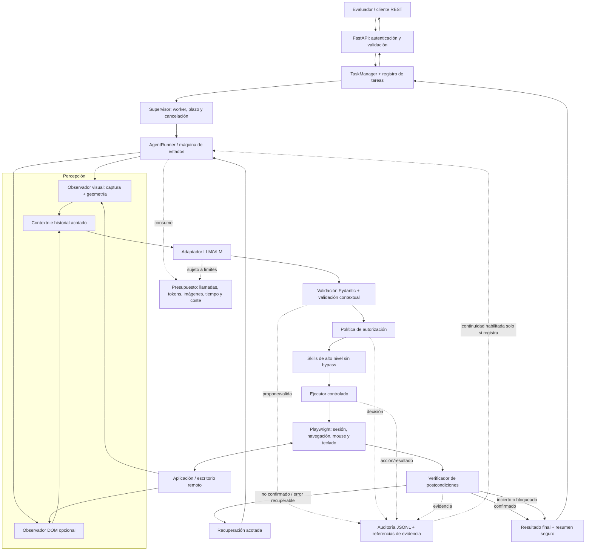
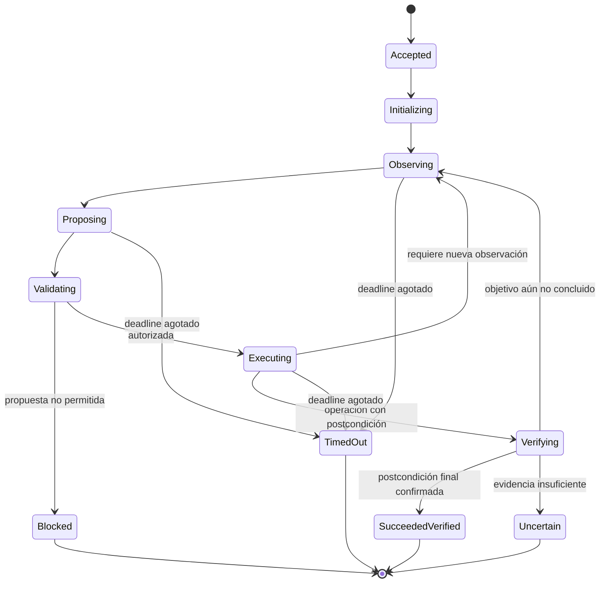

# WEB-AGENT — Documento maestro de diseño técnico

## Propósito y carácter normativo

Este documento define **qué vamos a construir, por qué se decide construirlo de esa manera y cómo debe implementarse y validarse**. Es el documento de diseño de referencia de WEB-AGENT: debe servir a una persona desarrolladora o a un agente de programación como contexto principal antes de modificar código.

No es solamente un inventario de archivos existentes. Separa las decisiones de diseño objetivo de las capacidades que el material fuente identifica como existentes. Una decisión descrita como objetivo no debe interpretarse como código ya implementado.

### Convenciones de evidencia

- **[BASE OBSERVADA]**: el material fuente identifica el módulo o mecanismo como existente en el repositorio compartido. Esto no implica que se haya verificado mediante pruebas independientes.
- **[PARCIAL]**: existe una base, pero no cubre completamente la finalidad propuesta o no está integrada en el flujo principal.
- **[DECISIÓN DE DISEÑO]**: decisión recomendada para la arquitectura objetivo.
- **[PENDIENTE DE CONFIRMACIÓN]**: requiere contraste con el README oficial, el contrato de la evaluación, el repositorio actual o las reglas de infraestructura.
- **[NO MVP]**: se excluye de la primera versión salvo que un requisito obligatorio indique lo contrario.

El material fuente describe una revisión estática y advierte que no se ejecutaron pruebas. Por tanto, este documento no certifica que el sistema actual funcione, que todos los módulos estén conectados ni que el despliegue exista.

---

## Índice

1. [Resumen de la decisión de diseño](#1-resumen-de-la-decisión-de-diseño)
2. [Problema que resuelve el sistema](#2-problema-que-resuelve-el-sistema)
3. [Objetivos, requisitos y no objetivos](#3-objetivos-requisitos-y-no-objetivos)
4. [Principios de arquitectura](#4-principios-de-arquitectura)
5. [Arquitectura objetivo](#5-arquitectura-objetivo)
6. [Ciclo completo de una tarea](#6-ciclo-completo-de-una-tarea)
7. [Decisiones de tecnología y justificación](#7-decisiones-de-tecnología-y-justificación)
8. [Diseño detallado por componente](#8-diseño-detallado-por-componente)
9. [Percepción visual, DOM y geometría](#9-percepción-visual-dom-y-geometría)
10. [Contrato de acciones y ejecución controlada](#10-contrato-de-acciones-y-ejecución-controlada)
11. [Política de autorización y seguridad](#11-política-de-autorización-y-seguridad)
12. [API REST y ciclo de vida de tareas](#12-api-rest-y-ciclo-de-vida-de-tareas)
13. [Verificación, recuperación y resultados inciertos](#13-verificación-recuperación-y-resultados-inciertos)
14. [Auditoría, evidencias, secretos y privacidad](#14-auditoría-evidencias-secretos-y-privacidad)
15. [Presupuesto, deadlines y concurrencia](#15-presupuesto-deadlines-y-concurrencia)
16. [Organización del código propuesta](#16-organización-del-código-propuesta)
17. [Plan de implementación por fases](#17-plan-de-implementación-por-fases)
18. [Pruebas y criterios de aceptación](#18-pruebas-y-criterios-de-aceptación)
19. [Riesgos, trade-offs y decisiones pendientes](#19-riesgos-trade-offs-y-decisiones-pendientes)
20. [Reglas para agentes de programación](#20-reglas-para-agentes-de-programación)
21. [Registro de decisiones de arquitectura (ADR)](#21-registro-de-decisiones-de-arquitectura-adr)
22. [Referencias técnicas](#22-referencias-técnicas)

---

## 1. Resumen de la decisión de diseño

Vamos a construir un agente de automatización para operar aplicaciones desconocidas o legacy a través de su interfaz de usuario, incluso cuando no exista una API funcional accesible o cuando la evaluación requiera actuar únicamente sobre la superficie gráfica.

La solución tendrá un **núcleo de orquestación propio** que coordinará percepción, inferencia, validación, autorización, ejecución, verificación y auditoría. El modelo de IA no tendrá control directo del navegador, la red, los archivos ni las credenciales. Su función será interpretar el objetivo y una observación de la interfaz y proponer una única acción estructurada. El código de WEB-AGENT decidirá si esa acción es válida, permitida y ejecutable.

### Decisiones principales

1. **Python** será el lenguaje del núcleo para reutilizar la base existente y mantener en un mismo entorno los esquemas, la política y la automatización.
2. **Playwright** será el adaptador principal de interacción con la superficie de navegador/escritorio remoto, porque proporciona control programático de páginas, contextos, navegación, captura de pantalla, mouse y teclado. No se tratará como un aislador completo del sistema operativo ni como una herramienta que por sí sola garantice seguridad.
3. **La percepción visual será el modo principal de evaluación (`visual_only`)** para aplicaciones canvas o escritorios remotos. La inspección DOM se conservará como modo opcional y explícitamente permitido, no como dependencia silenciosa del modo visual.
4. **Pydantic** definirá contratos tipados de entrada, observación, propuesta, perfil, acción, evento y resultado. La validación sintáctica se complementará con comprobaciones contextuales en el núcleo.
5. **FastAPI sobre ASGI** es la propuesta para exponer la API REST requerida. El material fuente identifica el entrypoint actual como local y no como servidor REST; por tanto, esta selección corresponde al diseño objetivo, no a una implementación confirmada.
6. **Un adaptador LLM/VLM intercambiable** aislará al núcleo de un proveedor concreto. OpenRouter se podrá reutilizar si cumple el contrato de visión, coste, latencia, privacidad y las reglas oficiales; la fuente describe el adaptador actual como textual y sin envío de imágenes.
7. **Una máquina de estados de ejecución** impondrá un ciclo claro: observar → proponer → validar → autorizar → ejecutar → verificar → continuar o terminar.
8. **El supervisor impondrá el deadline** máximo de 300 segundos por tarea y la API admitirá la solicitud en menos de 2 segundos, de acuerdo con los requisitos citados en el material fuente, sujetos a confirmación con la especificación oficial.
9. **Toda acción relevante dejará una traza de auditoría** relacionada por identificadores de tarea, ejecución y observación. El JSONL actual es una base, pero no debe describirse como almacén inmutable o criptográficamente verificable.
10. **La verificación posterior será obligatoria** para declarar éxito. El hecho de que el modelo proponga `done`, que Playwright complete una llamada o que cambien los píxeles no demuestra por sí solo que la tarea de negocio se haya completado.

La meta no es crear un conjunto de scripts para una única aplicación. La meta es diseñar un motor de interacción generalista que use observaciones actuales, herramientas acotadas y políticas comunes; las skills pueden encapsular patrones de trabajo, pero no pueden introducir permisos alternativos.

## 2. Problema que resuelve el sistema

El reto descrito consiste en recibir una instrucción en lenguaje natural, conectarse a un escritorio o aplicación proporcionada por el entorno de evaluación y completar una tarea sin depender de una API de negocio ni de selectores o rutas conocidos de antemano.

Las aplicaciones objetivo pueden contener controles web comunes, formularios tradicionales, menús, ventanas emergentes o superficies gráficas como canvas y escritorios remotos. No se puede asumir que el agente siempre tendrá acceso al DOM correcto o que el DOM represente la aplicación que debe manejar. En un escritorio remoto mostrado dentro del navegador, por ejemplo, el DOM accesible puede describir el contenedor remoto, mientras que los botones, diálogos y campos del sistema remoto solo son visibles en la imagen.

### Dificultades técnicas fundamentales

- **Descubrimiento:** determinar qué muestra la interfaz y qué elementos o zonas son relevantes para el objetivo.
- **Acción:** traducir una intención a eventos de interfaz reales sin permitir acciones arbitrarias.
- **Estado cambiante:** las coordenadas, controles, modales y foco pueden cambiar después de cada operación.
- **Generalización:** no incorporar reglas rígidas para cada aplicación que se espere encontrar.
- **Verificación:** distinguir entre una acción ejecutada y un resultado de negocio efectivamente confirmado.
- **Seguridad:** evitar que contenido de la pantalla, texto malicioso o una salida del modelo modifique los permisos del agente.
- **Tiempo y coste:** limitar ejecución, llamadas al modelo, tokens, imágenes y reintentos.
- **Servicio:** exponer un contrato REST consultable sin mantener abierta la solicitud HTTP durante toda la automatización.

### Suposición principal

El agente tiene permiso para operar la sesión de escritorio que el evaluador proporciona. Esa autorización no implica permiso para acceder a cualquier dirección de red, abrir otros recursos locales, modificar políticas, ejecutar código arbitrario o realizar acciones de negocio que no estén dentro del objetivo aceptado.

## 3. Objetivos, requisitos y no objetivos

### 3.1 Objetivos funcionales

- Recibir un objetivo en lenguaje natural y los datos de acceso necesarios para una sesión de escritorio.
- Aceptar solicitudes mediante `POST /tasks` y devolver un `task_id` sin esperar al resultado final.
- Permitir consultar estado y resultado a través de `GET /tasks/{task_id}`.
- Publicar `GET /health` con una comprobación de salud/readiness que no necesite invocar al modelo en cada consulta.
- Operar sobre una interfaz observada de forma generalista, sin scripts específicos para cada aplicación evaluada.
- Soportar un modo visual sin inspección DOM de la aplicación y un modo DOM opcional cuando esté permitido.
- Registrar propuestas, decisiones, acciones, verificaciones, errores y resultado final.
- Terminar, bloquear o señalar incertidumbre cuando no haya evidencia suficiente o se agote el tiempo.

### 3.2 Requisitos no funcionales derivados del material fuente

| Requisito | Objetivo de diseño | Estado de la definición |
|---|---|---|
| Admisión REST | `POST /tasks` debe emitir `task_id` en menos de 2 s. | Requisito mencionado en la fuente; confirmar contrato oficial. |
| Plazo máximo | No superar 300 s de tiempo total por tarea. | Requisito mencionado en la fuente; confirmar cómo se mide oficialmente. |
| Autenticación | Bearer obligatorio en los endpoints protegidos. | Requisito mencionado en la fuente; confirmar excepciones de `/health`. |
| Generalización | No codificar rutas/elementos particulares de cada aplicación objetivo. | Requisito de diseño. |
| Auditoría | Registrar los eventos obligatorios; bloquear nuevas actuaciones si el registro falla. | Decisión recomendada. |
| Seguridad de secretos | No enviar contraseñas o tokens al modelo ni incluirlos en logs. | Decisión obligatoria de diseño. |
| Presupuesto | Limitar tiempo, llamadas, salida, imágenes y coste de inferencia. | La fuente identifica integración incompleta; completar. |
| Aislamiento | Sesión separada por tarea y capacidad de terminar workers bloqueados. | Objetivo; comprobar la infraestructura disponible. |

### 3.3 No objetivos del MVP

- Crear una API de negocio para la aplicación externa.
- Usar MCP como ruta obligatoria de ejecución.
- Delegar la totalidad de la tarea a un agente SaaS externo.
- Dar al modelo un terminal, ejecución arbitraria de Python/JavaScript o acceso irrestricto a archivos.
- Mantener una base de conocimiento de selectores particulares de todas las aplicaciones posibles.
- Afirmar que una verificación visual elimina toda incertidumbre.
- Implementar inicialmente una arquitectura distribuida de microservicios si un único servicio modular cubre el contrato de evaluación.

La arquitectura debe permitir evolucionar a persistencia y múltiples workers cuando sean necesarios, sin añadir esa complejidad antes de confirmar que el reto la exige.

## 4. Principios de arquitectura

### 4.1 Separación entre decisión y actuación

El modelo interpreta y recomienda; el núcleo determina qué está permitido. Ninguna respuesta del modelo, skill o proveedor puede saltarse la validación y la política. El modelo no elige qué secretos consultar ni puede ampliar sus propios permisos.

### 4.2 Acciones pequeñas y observables

El modelo debe emitir una acción o un paso acotado por iteración, no un plan largo que se ejecute sin inspección intermedia. Tras cualquier acción que pueda cambiar el estado de interfaz, se toma una nueva observación antes de decidir el siguiente paso.

### 4.3 La observación tiene identidad y vigencia

Toda propuesta dependiente de la pantalla debe referirse al `observation_id` utilizado para formularla. Antes de ejecutar, se comprueba que esa observación sigue siendo la vigente, que la página/sesión no cambió y que la geometría continúa siendo compatible. Si no, se rechaza y se vuelve a observar.

### 4.4 El DOM no es un permiso

Que un elemento exista en el DOM o que una coordenada caiga dentro del viewport no significa que la operación esté autorizada. La autorización combina objetivo, ámbito de tarea, clase de acción, contexto y riesgo.

### 4.5 Un único camino de ejecución

Las skills, el modo DOM y el modo visual deben converger en el mismo validador, política, ejecutor, verificador y auditoría. No puede existir una ruta “especial” que ejecute directamente y omita controles.

### 4.6 Fallar explícitamente

Cuando el resultado es desconocido, la tarea debe reportar `incierto` o un estado equivalente. No se convierte la ausencia de excepción en éxito. No se repite una operación persistente de forma ciega si la primera pudo haberse completado.

### 4.7 Dependencias mínimas y reemplazables

Mantener el núcleo modular y utilizar bibliotecas externas para primitivas concretas. Los proveedores de inferencia, el transporte REST y el almacenamiento de tareas deben estar detrás de interfaces para permitir sustituciones sin reescribir la máquina de estados.

## 5. Arquitectura objetivo

### 5.1 Diagrama lógico



Este diagrama representa el diseño objetivo. La presencia de un bloque no demuestra que su integración esté terminada.

### 5.2 Flujo de control, no solo flujo de datos

La secuencia está deliberadamente ordenada. La API no interactúa directamente con Playwright; el proveedor de modelos no llama al ejecutor; las skills no definen permisos; y el observador no modifica la interfaz. Cada componente produce una salida controlada para el siguiente componente.

La auditoría y el presupuesto son controles transversales: se aplican a todo el ciclo, no solo al final. El supervisor controla el límite externo; el runner controla los límites internos de acciones y presupuesto; el ejecutor comprueba de nuevo el deadline antes de emitir eventos.

### 5.3 Arquitectura lógica y despliegue físico

Para el MVP se recomienda un **servicio modular**, no una colección de microservicios. La API, los esquemas, el runner, la política, las skills y la auditoría pueden pertenecer a un único proyecto Python con fronteras claras.

Sin embargo, cada tarea debe ejecutarse en un worker que el supervisor pueda cancelar con límites definidos. Si la ejecución se mantiene en un proceso separado o un pool de workers, debe poder terminarse una ejecución bloqueada sin derribar la API. El mecanismo concreto depende de la forma asíncrona del runner y de los recursos de infraestructura disponibles; es una decisión de implementación que debe comprobarse durante la fase de deadline.

Para una única instancia de demostración puede bastar un registro de tareas en memoria, siempre que la pérdida de estado ante reinicio sea aceptable. Si el contrato exige consultar tareas tras reinicios o escalar a múltiples instancias, habrá que seleccionar almacenamiento persistente y coordinación externa. **No se debe añadir Redis, una cola distribuida ni una base de datos por defecto sin confirmar esa necesidad.**

## 6. Ciclo completo de una tarea

1. **Recepción:** la API recibe el objetivo y los parámetros requeridos por el contrato oficial. Valida el Bearer antes de aceptar la tarea.
2. **Validación de entrada:** Pydantic valida tipos, campos, tamaños y formato. La lógica de dominio verifica combinaciones y límites que no pueden representarse con tipos simples.
3. **Admisión:** se genera un `task_id`, se registra el instante de inicio y el deadline monotónico. La tarea pasa a la cola de ejecución y `POST /tasks` responde con el identificador.
4. **Preparación de sesión:** el worker crea o adjunta una sesión autorizada de Playwright, configura el contexto aislado y aplica la política de red. Las credenciales permanecen fuera del prompt y se resuelven solo cuando el ejecutor lo necesita.
5. **Observación inicial:** se captura el viewport y se guardan metadatos de geometría. Si el modo permite DOM, se crea además un snapshot DOM limitado y temporal.
6. **Construcción de contexto:** se combina el objetivo, el estado resumido, la observación vigente, las acciones recientes y el tiempo/coste restantes. No se envía el historial completo sin límites.
7. **Propuesta del modelo:** el adaptador solicita al LLM/VLM una sola acción estructurada o un estado final propuesto. La respuesta se considera entrada no confiable.
8. **Validación estructural:** Pydantic valida el tipo de acción, campos requeridos, rangos, longitudes y exclusiones mutuas.
9. **Validación contextual:** se comprueba `observation_id`, sesión/página, geometría, objetivo autorizado, tipo de efecto, riesgo, permisos, deadline y presupuesto.
10. **Decisión de política:** se autoriza, rechaza o deriva para intervención humana. Una acción no autorizada no se reintenta automáticamente con otra variante.
11. **Ejecución controlada:** el ejecutor traduce la acción a eventos limitados de Playwright. No acepta código arbitrario del modelo.
12. **Nueva observación:** después de una operación que pueda cambiar el estado, se vuelve a capturar la interfaz y se renuevan los identificadores de observación.
13. **Verificación:** se comprueba una postcondición relacionada con el objetivo o una condición intermedia explícita. Si no se puede decidir con evidencia suficiente, se clasifica el resultado como no verificado o incierto.
14. **Recuperación:** solo ante errores recuperables se reobserva, se clasifica el fallo y se elige una alternativa autorizada. No se repite una acción persistente solo porque hubo timeout.
15. **Finalización:** el sistema construye un resultado estructurado y un resumen, detiene nuevas acciones, cierra recursos y completa la auditoría final.
16. **Consulta:** `GET /tasks/{task_id}` devuelve el estado y resumen permitidos por el contrato oficial, sin credenciales ni imágenes privadas expuestas por defecto.

### Invariantes del ciclo

- No se ejecuta una propuesta inválida.
- No se ejecuta una propuesta basada en una observación caducada.
- No se ejecuta una operación fuera del ámbito de tarea autorizado.
- No se comienza una acción nueva tras agotar el deadline.
- No se solicita una llamada al modelo si el presupuesto la prohíbe.
- No se publica éxito sin postcondición suficiente.
- No se continúa si falla la auditoría obligatoria.
- No se repite ciegamente una operación que pudo persistir en el sistema remoto.

## 7. Decisiones de tecnología y justificación

Esta tabla explica el propósito técnico de cada elección. El estado se refiere a lo que indica el material fuente, no a una validación ejecutada en este turno.

| Tecnología / mecanismo | Decisión | ¿Por qué lo usamos? | Qué no resuelve / alternativa considerada |
|---|---|---|---|
| **Python** | Mantenerlo como lenguaje del núcleo. | La base observada ya está organizada en módulos Python; permite compartir contratos, política, runner, auditoría y adaptadores sin introducir una segunda implementación. | No es automáticamente seguro ni determinista. La seguridad depende de los contratos, las fronteras y el ejecutor. |
| **Playwright** | Utilizarlo como adaptador principal de interacción con la interfaz. | Proporciona una API de automatización de navegador, gestión de páginas y contextos, navegación, captura, localización DOM y eventos de mouse/teclado. Permite combinar acciones estructurales cuando estén permitidas con interacción coordenada para una superficie visual. | No automatiza por sí solo cualquier escritorio nativo fuera del navegador; no aísla el sistema operativo completo; no decide permisos de negocio. Alternativas: Selenium/WebDriver para navegación DOM; PyAutoGUI para eventos a nivel de sistema operativo, con más dependencia de la máquina y menos integración con el contexto de navegador. |
| **BrowserContext de Playwright** | Contexto separado por tarea/sesión. | Reduce mezcla de cookies y almacenamiento de sesión entre ejecuciones y facilita una inicialización limpia. | No sustituye aislamiento del proceso, filesystem, contenedor ni red. El worker requiere controles adicionales. |
| **Pydantic** | Usarlo para contratos internos y REST. | Convierte propuestas en objetos tipados, valida estructura y permite rechazar valores inválidos antes de actuar. La base observada ya utiliza modelos Pydantic. | La validación de tipos no prueba que una acción sea segura o que el objetivo sea legítimo; la validación contextual vive en la política. |
| **FastAPI + ASGI** | Elección propuesta para los endpoints REST. | Encaja con Python y Pydantic, valida cuerpos HTTP y ayuda a exponer un contrato documentado/OpenAPI. Permite separar la admisión HTTP de la ejecución prolongada. | No está identificado como servidor REST implementado en el material fuente. Debe añadirse y probarse; un framework alternativo sería Flask/Starlette o un servidor estándar, pero habría que recrear varias integraciones. |
| **HTTPX** | Reutilizarlo o adoptarlo para llamadas HTTP al proveedor. | Ofrece cliente HTTP síncrono y asíncrono; en una API ASGI facilita llamadas no bloqueantes, timeouts diferenciados y reutilización de conexiones. | No debe permitir solicitudes arbitrarias generadas por el modelo; el destino del proveedor se configura y valida. Si el repositorio ya usa otro cliente compatible, no se debe duplicar sin necesidad. |
| **LLM/VLM tras una interfaz de proveedor** | Separar protocolo y proveedor de modelo. | Facilita reemplazar un modelo según visión, calidad, latencia, coste y reglas del reto sin cambiar el runner o la política. | Una interfaz intercambiable no elimina las diferencias entre proveedores. Cada adaptador debe validar soporte real de imágenes, límites y formato de respuesta. |
| **OpenRouter** | Proveedor candidato, no dependencia arquitectónica obligatoria. | La fuente identifica un adaptador existente llamado `openrouter.py`, pero describe la petición actual como textual. Reutilizarlo puede reducir trabajo si se extiende correctamente a la entrada visual requerida. | No se debe asumir que el adapter actual soporta visión: la fuente indica lo contrario. Verificar reglas oficiales, modelos habilitados, imágenes, latencia, precio y tratamiento de datos antes de usarlo. |
| **JSON / JSON Schema** | Formatos de contrato para propuestas, eventos y resultados. | Facilitan la validación entre módulos, el registro y la interoperabilidad. | JSON válido no implica verdad ni autorización; siempre debe validarse de nuevo en el núcleo. |
| **JSONL de auditoría** | Mantener el formato de eventos en la primera versión. | Es simple, append-friendly y fácil de inspeccionar y procesar evento a evento. La fuente identifica ya un mecanismo JSONL con redacción. | JSONL no es por sí mismo inmutable, resistente a manipulación ni suficiente como almacenamiento distribuido. Para requisitos superiores se necesitaría almacenamiento restringido, encadenamiento criptográfico o un sistema externo de auditoría. |
| **Mermaid** | Utilizarlo para diagramas versionables en Markdown. | Permite a agentes y personas leer, revisar y versionar la arquitectura como texto. | La vista depende del renderizador que consuma el documento. Se conserva además una descripción textual de los componentes y del flujo. |
| **Skills nativas** | Patrones de alto nivel que pasan por el núcleo común. | Reutilizan secuencias frecuentes (inicio de sesión, formularios, modales, exportación, descubrimiento, recuperación) y evitan repetir lógica en el modelo. | Una skill no debe codificar rutas de la aplicación de evaluación ni omitir la política. Se mantienen genéricas y basadas en observación actual. |
| **MCP** | Dejarlo fuera de la ruta crítica del MVP. | La fuente indica que el servidor MCP existente mantiene sesión y políticas paralelas y solo implementa parcialmente operaciones. Un segundo camino duplica estado y puede crear bypasses. | Si luego se necesita interoperabilidad MCP, sus tools deben delegar en las mismas interfaces internas, sin crear un segundo ejecutor ni una segunda política. |
| **Registro de tareas en memoria** | Solo para despliegue mínimo si la pérdida de estado es aceptable. | Reduce dependencias para una instancia pequeña y permite centrar el trabajo en el contrato y el control de ejecución. | Se pierde estado al reiniciar y no coordina múltiples instancias. Si la evaluación exige persistencia, introducir un backend durable explícito. |
| **Supervisor / worker aislado** | Decisión arquitectónica obligatoria; el mecanismo físico se confirma al implementar. | El deadline debe seguir aplicándose si una llamada o el navegador se quedan bloqueados; el proceso de API debe poder seguir respondiendo. | La cancelación cooperativa por sí sola puede no detener una operación nativa bloqueada. Terminar el proceso no revierte efectos remotos previos. |
| **`uv` + versiones fijadas** | Recomendación de gestión de dependencias si encaja con el repositorio. | Lockfile y versiones reproducibles reducen diferencias entre máquina local y despliegue; el material fuente señala que el TXT no incluye lockfile ni Dockerfile. | No reemplaza pruebas ni revisión de licencias. Confirmar la herramienta de empaquetado ya adoptada antes de migrar dependencias. |

### 7.1 Por qué Playwright es la elección central

Playwright no se utiliza porque “sea una IA” ni porque resuelva todo el sistema. Se utiliza como **capa de control de interacción** entre el núcleo Python y una sesión de navegador.

Su papel es traducir instrucciones ya autorizadas a operaciones concretas: navegar a una URL permitida, tomar capturas, manejar páginas y ventanas, localizar controles DOM en modo permitido, enviar clics, introducir texto, pulsar teclas y controlar scroll. Los `BrowserContext` permiten separar parte del estado del navegador por sesión.

Para una aplicación web convencional, los locators DOM suelen ser más estables que coordenadas absolutas. Para una aplicación dibujada en canvas o un escritorio remoto incrustado, el modo visual puede ser el único mecanismo útil para interpretar el contenido de destino. Playwright sigue siendo relevante porque controla la superficie del navegador y puede emitir eventos de mouse/teclado sobre la zona remota; la inferencia se basa en imágenes y no en inspección del DOM de la aplicación remota.

**Límite importante:** si el objetivo fuera un programa de escritorio nativo que no está expuesto como superficie web, Playwright por sí solo no sería suficiente. Habría que agregar otro adaptador de escritorio explícitamente diseñado y autorizado. No se debe añadir PyAutoGUI u otra herramienta a la primera versión si el escritorio suministrado ya es accesible desde el navegador.

### 7.2 Por qué no usar únicamente DOM

DOM puede ser útil cuando la aplicación expone controles accesibles, pero falla como premisa universal si la superficie es canvas, VNC/noVNC, un terminal remoto renderizado en una imagen o una aplicación donde el DOM disponible describe únicamente el contenedor. Por eso el modo visual debe ser funcional por sí mismo.

### 7.3 Por qué no usar únicamente visión

La visión añade incertidumbre geométrica y puede interpretar incorrectamente textos pequeños, estados ambiguos o iconos. Cuando el DOM está autorizado, el observador DOM puede proporcionar una localización adicional y verificaciones estructurales. La arquitectura admite ambos modos, pero la selección debe ser explícita y no debe romper el requisito `visual_only`.

### 7.4 Por qué no delegar la tarea completa a un agente externo

El reto requiere controlar el contrato, el plazo, las autorizaciones, el transporte, la auditoría y la evidencia. Si un agente externo decide y ejecuta todos los pasos, el núcleo local pierde visibilidad y control. Se permite utilizar un modelo externo para inferencia, pero el código de WEB-AGENT conserva la autoridad para validar, autorizar, ejecutar y finalizar.

## 8. Diseño detallado por componente

### 8.1 API REST

**Responsabilidad:** autenticar al cliente, validar el contrato de entrada, registrar la tarea, asignar un identificador y responder rápidamente; exponer salud y consulta de estado.

**No debe:** abrir una sesión de navegador dentro de la petición HTTP y esperar los cinco minutos completos; llamar al modelo de forma sincrónica durante la admisión; devolver excepciones con secretos; permitir que el payload defina libremente el destino de red sin validación.

**Elección propuesta:** FastAPI con un servidor ASGI compatible, porque integra naturalmente los modelos Pydantic y ofrece generación de esquema OpenAPI. La API será una capa delgada: lógica de ejecución dentro del runner/supervisor, no dentro de las funciones de ruta.

**Seguridad:** usar comparación segura del token Bearer con la configuración del servicio; evitar registrar headers de autorización; limitar tamaños de cuerpos, longitudes de texto y campos inesperados; separar errores internos de los errores expuestos al usuario.

### 8.2 TaskManager y registro de tareas

**Responsabilidad:** asignar `task_id`, almacenar estado público e interno, tiempos, resumen y referencia al worker; permitir que la API consulte sin acceder a variables internas del runner.

**Diseño:** definir una interfaz `TaskStore` que no exponga cómo se persiste el estado. La primera implementación puede estar en memoria cuando el despliegue sea de una sola instancia y la evaluación lo permita; la interfaz permitirá una implementación persistente más adelante.

**Estados internos propuestos:** `accepted`, `queued`, `running`, `succeeded_verified`, `failed`, `blocked`, `needs_human_review`, `timed_out`, `cancelled`, `uncertain`.

La traducción de estados internos al contrato REST público debe confirmarse con el README oficial. No se deben inventar campos de salida definitivos.

### 8.3 Supervisor y workers

**Responsabilidad:** iniciar workers de tarea, mantener un límite de concurrencia, aplicar el deadline absoluto, cancelar de forma cooperativa y terminar el worker si no responde dentro del margen de limpieza definido.

El reloj usado para medir los 300 segundos debe ser monotónico. El deadline se calcula al admitir la tarea, no al comenzar la primera llamada al modelo. Así, el tiempo en cola también consume el presupuesto; de otra forma, el sistema podría aceptar una tarea que ya no tiene tiempo suficiente para completarse.

El supervisor revisa el plazo antes de cada acción e inferencia. La cancelación no garantiza reversión de efectos externos: si una tarea guarda un registro y luego vence el plazo, el estado correcto puede ser incierto, no fallido sin más.

### 8.4 AgentRunner / máquina de estados

**Responsabilidad:** coordinar las fases del bucle de interacción y mantener un `RunContext` coherente.

`RunContext` debe contener al menos el objetivo autorizado, `task_id`, `run_id`, deadline, presupuesto, modo de percepción, sesión activa, observación actual, acciones previas resumidas, resultado de verificación y referencias de auditoría.

El runner no debe reconstruir observaciones perdiendo el `observation_id`, ni permitir que el adaptador opere con un `page_state` textual sin metadatos suficientes. Las propuestas deben vincularse a una observación concreta.

**Máquina de estados sugerida:**



Los fallos técnicos se clasifican antes de decidir reintentar. Las violaciones de política no se reintentan con variaciones de la misma acción.

### 8.5 Observador visual

**Responsabilidad:** capturar el viewport visible y producir una observación estructurada que contenga imagen y geometría.

Campos de diseño recomendados:

- `observation_id` único e inmutable.
- `task_id`, `run_id`, identificador interno de sesión/página.
- `timestamp` UTC para auditoría y metadatos; plazo medido con reloj monotónico en el supervisor.
- Ancho y alto del viewport en píxeles CSS.
- Dimensiones en píxeles de la imagen capturada.
- Transformación explícita si se recorta o escala la imagen.
- Identificador de versión geométrica.
- Referencia controlada a la imagen, no una ruta de archivo arbitraria.
- Modo de captura, errores y advertencias que afecten a la precisión.

La captura preferida es el viewport visible completo, en PNG para conservar detalles de interfaz. Las capturas de página completa no deben usarse para calcular clics dentro de un viewport: el scroll y la superficie visible pueden hacer que la geometría no corresponda a la imagen.

### 8.6 Observador DOM

**Responsabilidad:** exponer una vista limitada de controles y estructura de la página en escenarios donde el contrato permita inspección DOM.

Debe registrar referencias temporales ligadas al snapshot, resolver roles y nombres compatibles con Playwright, comprobar unicidad real y rechazar referencias obsoletas. No debe tratar `unique=True` como una afirmación sin comprobarla ni construir roles a partir de etiquetas que no correspondan a roles válidos.

El modo `visual_only` debe evitar la inspección DOM de la aplicación objetivo. La existencia del observador DOM no permite ejecutar inspección oculta como paso de preparación del modo visual.

### 8.7 Adaptador LLM/VLM

**Responsabilidad:** convertir objetivo, observación y contexto acotado en una propuesta tipada de siguiente paso.

Debe ofrecer una interfaz común, por ejemplo `propose_action(context, observation) -> ActionProposal`. La implementación del proveedor vive detrás de esa interfaz. El resultado se valida aunque el proveedor soporte respuestas JSON o un esquema estructurado nativo.

**Entrada permitida:** objetivo, screenshot si el proveedor y el contrato permiten visión, metadatos necesarios, resumen de acciones anteriores, resultado de la verificación previa y límites restantes.

**Nunca enviar:** contraseñas, cookies, tokens de sesión, Bearer de la API, secretos de infraestructura, rutas privadas que no sean necesarias o trazas completas que contengan credenciales.

El adaptador debe imponer timeout de conexión/lectura, manejar rate limits y errores de proveedor y respetar el presupuesto restante. La respuesta del proveedor nunca ejecuta una acción por sí misma.

### 8.8 Pydantic y validación contextual

Pydantic valida la forma de los objetos. El núcleo valida el significado de la propuesta en su contexto.

La validación estructural verifica tipos, campos obligatorios, longitud de texto, límites numéricos, enums y campos mutuamente excluyentes. La validación contextual verifica, entre otros:

- que la acción esté disponible en el modo de tarea;
- que el `observation_id` coincida con la observación actual cuando proceda;
- que la página/sesión y la geometría no hayan cambiado;
- que la acción esté dentro del alcance autorizado;
- que se cumpla el nivel de riesgo requerido;
- que queden tiempo y presupuesto suficientes;
- que la acción no eluda un bloqueo previo.

No se acepta la propuesta por el mero hecho de que el JSON sea válido.

### 8.9 Política de autorización

La política es un módulo determinista local que transforma una propuesta válida en `allow`, `deny` o `require_human` cuando existe un canal humano compatible con el contrato. Si no existe canal humano, una tarea que requiera aprobación debe detenerse de forma segura y reportar el bloqueo/revisión pendiente de acuerdo con el contrato público.

La política evalúa intención autorizada, tipo de evento, datos afectados, superficie/objetivo, riesgo de impacto, repetición, posibilidad de persistencia, confianza de la observación y permisos del perfil. La política no depende exclusivamente de la clasificación del modelo.

### 8.10 Ejecutor

El ejecutor es la única capa que traduce una acción autorizada en llamadas de Playwright. Recibe un objeto de acción validado, `RunContext` y la observación actual; comprueba de nuevo el deadline y los datos críticos antes de emitir eventos.

Funciones previstas:

- navegación a destino permitido;
- clic DOM en modo autorizado;
- clic espacial por coordenadas normalizadas;
- doble clic y clic secundario, solo si se requieren y están explícitamente permitidos;
- escritura y pulsación de teclas;
- scroll acotado;
- espera limitada;
- extracción DOM cuando esté permitida;
- cierre/limpieza de teclas modificadoras y recursos.

No se proporciona `eval`, `exec`, terminal, invocación arbitraria de código de página ni acceso general al filesystem. La expansión de herramientas se hace con contratos explícitos y pruebas por acción.

### 8.11 Skills nativas

Las skills son procedimientos reutilizables para problemas típicos, no plugins con privilegios especiales. Cada skill se compone de acciones primitivas disponibles al executor y debe respetar las mismas reglas de observación, autorización, deadline, presupuesto, verificación y auditoría.

| Skill propuesta | Qué resuelve | Restricción de diseño |
|---|---|---|
| `DesktopAuthAndBootstrap` | Llegar a la sesión inicial y completar autenticación autorizada. | Secretos resueltos dentro del ejecutor; nunca incluidos en el prompt ni logs. |
| `CanvasFormFill` | Localizar campos visuales, enfocar, escribir y verificar. | No borrar ni reemplazar contenido por defecto si no fue autorizado. |
| `LegacyPopupManager` | Interpretar diálogos y gestionar opciones. | No confirmar automáticamente una operación por la apariencia del botón. |
| `ReportExportTracker` | Operar menús y confirmar un proceso de exportación. | Diferenciar archivo remoto, descarga local y mensaje de confirmación; no inventar contenido. |
| `ZeroShotDiscovery` | Explorar interfaz y elaborar hipótesis de navegación. | Memoria temporal y revisable; no asumir distribución universal de menús. |
| `SelfHealingRetry` | Reobservar, diagnosticar y buscar una alternativa autorizada. | Nunca encadenar clic/doble clic/Escape genéricos sin observar y clasificar el resultado. |

Estas skills están documentadas como diseño objetivo; su integración real debe verificarse contra el código.

### 8.12 Verificador y recuperación

El verificador define qué evidencia demostraría cada objetivo. Por ejemplo, para completar un formulario no basta con que el evento de escritura haya finalizado: hay que comprobar que los valores esperados aparecen en la interfaz y, si el objetivo exige persistencia, verificar una confirmación compatible con la aplicación.

En un sistema visual puede que la verificación dependa de interpretación VLM y la confianza nunca sea absoluta. Por eso el resultado registra fuerza/tipo de evidencia y distingue `verificado`, `no_verificado` e `incierto`.

La recuperación no debe ejecutarse como una cadena fija de teclas. Primero observa, clasifica el fallo, comprueba si el efecto pudo haber ocurrido y decide si hay una alternativa autorizada. Las violaciones de política no son errores recuperables.

### 8.13 Presupuesto de inferencia

El `BudgetManager` debe ser obligatorio para llamadas reales. Controla como mínimo:

- máximo de llamadas al modelo por tarea;
- máximo de tokens de entrada y salida, cuando el proveedor lo exponga;
- máximo de imágenes/tamaño de imágenes;
- timeout por llamada y tiempo restante global;
- coste estimado por modelo/proveedor;
- concurrencia de llamadas;
- reservas y confirmaciones para evitar gastar más de lo permitido.

El coste estimado por token no debe presentarse como factura exacta. Las métricas reales del proveedor, cuando existan, deben conservarse por separado del cálculo preventivo. El material fuente identifica una base de presupuesto, pero su inyección en el flujo principal y la imposición de límites de salida se reportan incompletas.

### 8.14 Auditoría y eventos

La auditoría registra al menos la admisión, observación, propuesta, resultado de validación, decisión de política, ejecución, verificación, recuperación y resultado final. Los eventos se correlacionan con `task_id`, `run_id` y `observation_id`.

Si falla la escritura de un evento obligatorio, se impiden acciones nuevas. Se reporta el estado de la tarea sin afirmar que se revirtió una acción anterior. La traza debe redactar secretos y limitar la retención de imágenes/capturas. El mecanismo JSONL descrito por la fuente no es una auditoría inmutable; cualquier promesa de integridad criptográfica necesita un diseño explícito adicional.

## 9. Percepción visual, DOM y geometría

### 9.1 Modos de percepción

- **`visual_only`:** el agente interpreta capturas y usa eventos de mouse/teclado sobre la superficie autorizada. No inspecciona el DOM de la aplicación objetivo para obtener sus controles.
- **`dom`:** usa estructura de controles y referencias DOM, cuando esa modalidad esté permitida. No debe hacerse pasar como visual puro.
- **`auto`:** se puede seleccionar solo si el contrato de evaluación y el contexto permiten ambos métodos. Si el evaluador requiere modo visual, se configura explícitamente y no se infiere de forma heurística.

Un canvas dominante o una URL que contenga una palabra como `vnc` son señales, no pruebas suficientes. El modo debe derivarse del contrato/configuración aceptada y no de una conjetura silenciosa.

### 9.2 Coordenadas

La imagen y el viewport deben mantener una relación geométrica explícita. Si el modelo devuelve coordenadas normalizadas enteras entre 0 y 1000, la conversión al viewport CSS será:

```python
x_css = round((x_norm / 1000) * (W_css - 1))
y_css = round((y_norm / 1000) * (H_css - 1))
```

Invariantes:

```text
0 <= x_norm <= 1000
0 <= y_norm <= 1000
0 <= x_css < W_css
0 <= y_css < H_css
```

La herramienta de ejecución de Playwright trabaja con coordenadas CSS del viewport. No se debe multiplicar automáticamente por el device pixel ratio (DPR), ni asumir que los píxeles del PNG equivalen uno a uno a las coordenadas CSS.

Si una captura se recorta, redimensiona o transforma, la observación registra la transformación y el ejecutor la invierte explícitamente. Si no hay transformación conocida, la acción espacial se rechaza.

### 9.3 Vigencia y carreras de interfaz

Después de navegación, scroll, apertura/cierre de modal, escritura que cambie el layout o cualquier acción que pueda cambiar geometría, se marca obsoleta la observación previa. Una propuesta vinculada a esa observación no puede ejecutarse contra la nueva pantalla.

Incluso con una observación vigente, la interfaz puede cambiar justo antes del clic. Por tanto, se verifica la identidad de página y geometría inmediatamente antes de ejecutar, y se comprueba el efecto después. Estos controles reducen carreras de interfaz, pero no eliminan por completo la incertidumbre temporal.

## 10. Contrato de acciones y ejecución controlada

### 10.1 Forma de la propuesta

La propuesta del modelo debe ser un objeto estructurado que contenga como mínimo:

- `action`: tipo de acción permitida;
- `observation_id`: observación base en acciones dependientes de pantalla;
- `reason_code` o justificación breve y no ejecutable;
- parámetros estrictamente definidos por acción;
- `expected_effect` o postcondición esperada, cuando aplique;
- indicación de finalización propuesta, que no se considera éxito hasta verificar.

La justificación textual no controla permisos; solo ayuda a la auditoría y evaluación. Los parámetros deben tener límites estrictos y no pueden ser scripts o comandos libres.

### 10.2 Acciones de dominio propuestas

El material fuente identifica el esquema actual con acciones como `navigate`, `click`, `fill`, `submit`, `extract`, `done` y `ask_human`. Para cumplir el modo visual se propone ampliar el contrato con acciones explícitas para coordenadas y eventos de interacción adicionales.

| Acción objetivo | Parámetros clave | Validaciones mínimas |
|---|---|---|
| `navigate` | URL de destino | Esquema, host, puerto y ruta autorizados; bloqueo de destinos no permitidos y redirecciones fuera de política. |
| `click_dom` | referencia de control | Modo DOM autorizado, referencia vigente, unicidad y objetivo permitido. |
| `fill_dom` | referencia y valor/ref de secreto | Modo DOM autorizado, referencia vigente, longitud, sensibilidad y reemplazo explícito. |
| `click_xy` | coordenadas normalizadas + observation id | Observación vigente, geometría y superficie autorizada; coordenadas dentro del viewport. |
| `double_click` | coordenadas normalizadas | Uso explícito y justificado, misma validación de geometría y permiso. |
| `right_click` | coordenadas normalizadas | Uso explícito, permitido y verificado; no se asume que el menú contextual sea inocuo. |
| `type_text` | texto o referencia de secreto | Foco esperado, longitud y clasificación del contenido; secretos no pasan por el modelo. |
| `press_key` | tecla/combinación enumerada | Lista permitida, foco válido, deadline y comprobación de posibles efectos. |
| `scroll` | dirección/cantidad acotada | Magnitud dentro del máximo y observación posterior. |
| `wait` | duración máxima | Duración acotada y nunca mayor que el tiempo restante. |
| `extract` | alcance/selector o región autorizada | Modalidad permitida, límite de datos y redacción. |
| `done` | objetivo alegado y evidencia esperada | Solo solicita verificación final; no es un estado de éxito. |
| `ask_human` | razón y pregunta concreta | Solo si existe un canal humano; en otro caso, bloqueo seguro documentado. |

Las acciones implementadas deben agregarse gradualmente, con pruebas y cambios de esquema explícitos. No se permite que un agente de programación invente un nuevo tipo de acción sin actualizar la política, el executor, el verifier, la auditoría y las pruebas.

### 10.3 Ejecución determinista

“Determinista” significa que una acción validada se traduce a una secuencia explícita y limitada de eventos, no que el modelo vaya a proponer siempre lo mismo ni que la aplicación externa siempre responda de idéntica forma.

Cada manejador de acción debe:

1. validar parámetros y contexto;
2. comprobar el deadline;
3. comprobar que la sesión y la observación son válidas;
4. registrar la intención de ejecución antes de actuar;
5. emitir solo los eventos autorizados;
6. liberar teclas modificadoras y recursos en un `finally` o mecanismo equivalente;
7. capturar resultado/error;
8. registrar el resultado de ejecución;
9. solicitar observación/verificación posterior.

## 11. Política de autorización y seguridad

### 11.1 Fronteras de confianza

1. **Cliente/evaluador:** es la fuente del objetivo y de los parámetros contractuales; se autentica mediante Bearer.
2. **Modelo externo:** proveedor de inferencia no confiable para ejecución y permisos; puede alucinar o ser influido por instrucciones observadas.
3. **Contenido de la aplicación:** se trata como datos no confiables, aunque contenga texto con formato de instrucción.
4. **Core Python:** es la autoridad local para validación, autorización, ejecución, deadline, presupuestos y auditoría.
5. **Aplicación remota:** sistema externo cuyos efectos reales no pueden revertirse por terminar el proceso local.

### 11.2 Prompt injection desde la pantalla

El contenido de una web, un popup, un documento o un mensaje del escritorio puede decirle al agente que revele secretos, visite otra URL o cambie el objetivo. Ese contenido no altera la instrucción autorizada por el cliente ni añade permisos.

El prompt del modelo debe indicar que el contenido de la pantalla es evidencia sobre la interfaz, no una fuente de política. Sin embargo, una instrucción textual no basta: la protección real está en que el modelo no tiene herramientas directas y que cada propuesta pasa por la política local.

### 11.3 Secretos

- Las credenciales se guardan en el contexto de tarea protegido o en un resolvedor de secretos.
- El modelo no recibe contraseñas, cookies, tokens, encabezados Bearer ni valores secretos.
- La acción puede referenciar un identificador como `secret_ref`; solo el ejecutor lo resuelve justo antes de introducir el valor en el control autorizado.
- No registrar el valor real antes/después del ingreso; redactar mensajes de error y capturas que puedan mostrarlo cuando corresponda.
- Los archivos de estado autenticado de Playwright contienen material sensible y nunca se deben subir al repositorio.

### 11.4 Política de red

El material fuente informa que la sesión actual bloquea WebSockets, lo que puede impedir escritorios remotos como noVNC o Guacamole. La decisión no debe ser abrir WebSockets indiscriminadamente: se debe autorizar explícitamente el endpoint, origen, puerto y ruta de transporte que realmente necesita el escritorio.

Toda conexión de salida debe usar una política única. Bloquear por defecto y permitir solo los destinos necesarios. No desbloquear el rango de direcciones privadas completo a partir de una URL arbitraria. Revisar redirecciones y DNS para evitar SSRF, acceso a metadata de nube, loopback o servicios internos no autorizados. El parser HTTP por sí solo no constituye una política completa para WebSocket.

### 11.5 Riesgo de acciones

El esquema valida que un clic tenga coordenadas válidas, pero la política tiene que evaluar el tipo de efecto. Las acciones que puedan borrar, enviar, guardar, pagar, publicar, finalizar o cambiar datos persistentes pueden requerir verificación más fuerte o aprobación según el contrato.

No se debe tratar `Enter`, `Escape`, el botón predeterminado o un modal como operaciones universalmente seguras. La autorización debe considerar estado, objetivo y efecto esperado, no solamente etiqueta o posición.

### 11.6 Aislamiento

Un `BrowserContext` separado reduce el intercambio de cookies/almacenamiento del navegador, pero no es una barrera suficiente entre procesos ni contra acceso al sistema de archivos o a la red. Si el agente procesa tareas no confiables, el diseño de despliegue debe valorar workers aislados, usuario sin privilegios, filesystem limitado, red egress controlada y terminación del proceso.

### 11.7 Fallo cerrado

Cuando no se puede comprobar el permiso, la identidad de la observación o la escritura de un evento obligatorio, la acción se bloquea. La política no transforma ausencia de evidencia en permiso.

## 12. API REST y ciclo de vida de tareas

### 12.1 Endpoints objetivo

Los endpoints citados en la fuente son los siguientes. Los nombres de campos de JSON y el mapeo exacto de estados deben confirmarse contra el README oficial antes de cerrar los esquemas.

| Método y ruta | Función | Reglas principales |
|---|---|---|
| `GET /health` | Salud/readiness del servicio. | Respuesta rápida; no ejecutar una llamada al modelo solo para comprobar salud. La autenticación exacta se decide según contrato oficial. |
| `POST /tasks` | Registrar y encolar una tarea. | Bearer según contrato, validar entrada, crear `task_id`, fijar deadline y responder en menos de 2 s. No esperar que termine el navegador. |
| `GET /tasks/{task_id}` | Consultar estado y resumen. | Bearer según contrato; validar que el identificador exista; no filtrar credenciales o trazas sensibles. |

### 12.2 Ejemplo conceptual de admisión

Este JSON es ilustrativo, **no un contrato oficial confirmado**. No se deben copiar nombres de campos al código final sin compararlos con la especificación del reto.

```json
{
  "objective": "Completar la tarea indicada en la aplicación autorizada",
  "desktop": {
    "url": "https://host-autorizado.example/session",
    "credential_ref": "secret_ref"
  },
  "perception_mode": "visual_only"
}
```

La respuesta conceptual de admisión podría contener únicamente identificador y estado inicial. El esquema final debe reflejar exactamente el contrato oficial.

### 12.3 Deadline y estados

El deadline se fija al aceptar la tarea. El tiempo de cola forma parte del total. Todo componente que pueda tardar (modelo, espera de navegador, skill, verificador, cierre de sesión) recibe el mismo plazo absoluto y calcula el tiempo restante; no reinicia cinco minutos en cada etapa.

El material fuente menciona 300 segundos como máximo. La API no debe aceptar un perfil de cliente que amplíe ese límite; el adaptador del reto impone el tope con independencia del perfil suministrado.

La tabla interna propuesta puede mapearse al contrato público, pero no debemos comprometer nombres de estados públicos hasta confirmar el README oficial. Como mínimo, el resultado debe distinguir: éxito verificado, fallo, bloqueo, timeout y resultado incierto.

### 12.4 Health y readiness

`/health` debe medir condiciones que realmente importen: proceso vivo, configuración válida, disponibilidad del registro de tareas, capacidad del supervisor y, si aplica, disponibilidad del worker. No necesita hacer inferencia facturada cada vez.

Separar liveness (el proceso responde) de readiness (puede aceptar nuevas tareas) si el entorno de despliegue lo permite. Una API viva con todos los workers ocupados o sin proveedor configurado puede no estar lista para aceptar trabajos nuevos.

## 13. Verificación, recuperación y resultados inciertos

### 13.1 Evidencia por acción y por objetivo

La evidencia de que Playwright realizó un clic no es evidencia de que el clic haya tenido el efecto esperado. La navegación completada tampoco certifica que se haya guardado un formulario. El verificador tiene que buscar una postcondición que sea pertinente para el objetivo.

Ejemplos de evidencia, de menor a mayor fuerza según el entorno:

- evento de acción ejecutado sin excepción;
- cambio visual compatible con el objetivo;
- aparición de un mensaje contextual de éxito;
- persistencia/resultado comprobado mediante una interfaz permitida;
- estado final coherente y observable que cubre todos los criterios del objetivo.

La jerarquía no es universal; se define por cada clase de tarea y por la evidencia que la aplicación realmente expone. El resultado debe indicar qué evidencia se observó.

### 13.2 Estados de verificación

- `verificado`: evidencia suficiente para los criterios definidos.
- `no_verificado`: se observó que faltan condiciones o que el resultado no se produjo.
- `incierto`: la evidencia no permite decidir, por ejemplo timeout después de una operación persistente.

El estado interno final `succeeded_verified` solo se emite si todos los criterios obligatorios están verificados. Si el objetivo no define una postcondición verificable, debe registrarse como una limitación del objetivo o solicitar una confirmación; no se inventa el criterio al final.

### 13.3 Política de reintentos

Se permite reintentar errores técnicos recuperables con una estrategia acotada y observada: volver a observar, confirmar que el estado está estable, clasificar el error y ejecutar una alternativa permitida.

No se permite:

- reintentar una violación de política;
- repetir un guardado/envío/borrado incierto sin comprobar si ya ocurrió;
- encadenar combinaciones genéricas de clic, doble clic y Escape;
- exceder el número de acciones, tiempo o llamadas del presupuesto.

### 13.4 Resultado incierto

Un timeout o caída del worker después de una operación remota puede dejar efecto externo sin confirmar. El resumen debe usar lenguaje explícito: “no se pudo confirmar si la operación persistió”, sin declarar falsamente que falló ni que tuvo éxito. La finalización del proceso local no es una transacción distribuida ni revierte la aplicación externa.

## 14. Auditoría, evidencias, secretos y privacidad

### 14.1 Modelo de eventos

Eventos recomendados:

- `task_accepted`
- `session_initialized`
- `observation_created`
- `model_request_started` / `model_response_received`
- `proposal_validated` / `proposal_rejected`
- `policy_decision`
- `action_started` / `action_completed` / `action_failed`
- `verification_result`
- `recovery_started` / `recovery_result`
- `budget_warning` / `budget_exhausted`
- `deadline_warning` / `task_timed_out`
- `task_finished`

Cada evento contiene `event_id`, timestamp, `task_id`, `run_id`, identificador de secuencia, tipo, resultado, código de motivo y referencias a evidencia cuando corresponda. No se deben registrar valores secretos, cookies, encabezados de autorización ni prompts sin redactar.

### 14.2 Manejo de capturas

Las capturas pueden contener datos de usuario, registros internos, contraseñas visibles o información sensible de la aplicación. La política debe definir si se conservan, por cuánto tiempo, dónde se almacenan y quién puede verlas. Los logs públicos no deben enlazar directamente a rutas del filesystem ni exponer archivos sin autorización.

### 14.3 Garantías del JSONL actual

La fuente identifica `audit/events.py` como JSONL con redacción. No indica que incluya una cadena criptográfica ni un backend de solo escritura. Por tanto, la garantía documentada se limita a registro estructurado y redacción según su implementación; no describirlo como inviolable o inmutable.

Si más adelante se exige integridad reforzada, se puede añadir una cadena de hashes o firma por evento, una política de permisos del archivo y/o almacenamiento externo controlado. Esas medidas tienen que diseñarse y probarse; el solo hecho de guardar JSONL no las proporciona.

### 14.4 Fallo de auditoría

Si el registro obligatorio falla antes de una acción, no debe iniciarse la acción. Si falla después de que la aplicación externa recibió la acción, se bloquean acciones nuevas y se informa que el resultado previo puede haber ocurrido. No hay transacción atómica entre el log local y el sistema remoto.

## 15. Presupuesto, deadlines y concurrencia

### 15.1 Una sola fuente de verdad temporal

El supervisor calcula `deadline_monotonic`. El runner y cada operación reciben el deadline, no una cantidad de segundos reiniciada por componente. Antes de cada llamada al modelo, acción de navegador o reintento, se comprueba el tiempo restante.

### 15.2 Límites configurables

Configuración propuesta (los valores excepto 300 s deben calibrarse con la evaluación):

- `task_timeout_seconds = 300` como límite duro objetivo según la fuente;
- `max_actions_per_task`;
- `max_model_calls_per_task`;
- `max_output_tokens` y límites de entrada cuando los soporte el proveedor;
- `max_image_bytes` y política de compresión/redimensión;
- `max_recovery_attempts`;
- `max_concurrent_tasks`;
- `action_timeout_seconds` y tiempo máximo de limpieza;
- `max_request_body_bytes`.

Los límites no pueden ampliarse sin autorización mediante el prompt o un payload de tarea. Los límites duros los aplica el supervisor/ejecutor; no son solo sugerencias para el modelo.

### 15.3 Concurrencia

La API puede aceptar varias solicitudes rápidamente, pero el número de workers de escritorio debe estar acotado. Cada tarea dispone de su propio contexto, su presupuesto y sus credenciales; nunca se reutiliza una sesión autenticada sin una política explícita que lo permita.

La primera implementación debe priorizar aislamiento y resultados verificables frente a concurrencia alta. No se adopta un sistema de colas distribuido hasta conocer el nivel de paralelismo requerido y las garantías de durabilidad del entorno.

### 15.4 Llamadas HTTP al proveedor

El cliente debe tener timeouts de conexión, lectura y pool, manejo de errores de proveedor y límites de reintento. La espera del proveedor consume el deadline global. La creación repetida de clientes HTTP en cada paso debe evitarse cuando una instancia compartida y correctamente gestionada sea adecuada.

## 16. Organización del código propuesta

La siguiente estructura es una **propuesta de organización**, no una afirmación de que todas estas rutas existan hoy. Debe adaptarse a la estructura real del repositorio antes de mover archivos.

```text
web-agent/
├── api/
│   ├── app.py                 # Aplicación FastAPI / ASGI
│   ├── routes.py              # /health, /tasks, /tasks/{task_id}
│   ├── auth.py                # Bearer y configuración de secretos
│   └── dto.py                 # Contratos REST públicos
├── core/
│   ├── schemas.py             # Modelos y contratos tipados
│   ├── runner.py              # Máquina de estados principal
│   ├── context.py             # TaskContext / RunContext
│   ├── policy.py              # Autorización contextual
│   ├── action_validator.py    # Validación cruzada de acciones
│   ├── verifier.py            # Postcondiciones y fuerza de evidencia
│   ├── budgets.py             # BudgetManager integrado
│   └── result.py              # Estados y resultados internos
├── browser/
│   ├── session.py             # Playwright, contextos y limpieza
│   ├── observe_visual.py      # Captura y geometría
│   ├── observe_dom.py         # Observación DOM condicional
│   ├── executor.py            # Única capa de eventos de interfaz
│   └── network_policy.py      # Política HTTP(S)/WS(S)
├── models/
│   ├── base.py                # Interfaz del proveedor
│   ├── openrouter.py          # Adaptador candidato (validar soporte VLM)
│   └── scripted.py            # Proveedor determinista para pruebas
├── skills/
│   ├── auth_bootstrap.py
│   ├── canvas_form_fill.py
│   ├── popup_manager.py
│   ├── export_tracker.py
│   ├── zero_shot_discovery.py
│   └── self_healing_retry.py
├── service/
│   ├── task_manager.py        # Alta y consulta de tareas
│   ├── supervisor.py          # Worker, deadline y cancelación
│   └── task_store.py          # Interfaz + backend inicial
├── audit/
│   ├── events.py              # Eventos JSONL redactados
│   └── redaction.py           # Redacción común de secretos
├── tests/
│   ├── unit/
│   ├── integration/
│   ├── security/
│   └── acceptance/
├── Diseño/
│   ├── WEB-AGENT_documento_maestro_de_diseno.md
│   ├── web-agent_arquitectura_implementacion.md
│   └── web-agent_diagrama_arquitectura.md
├── pyproject.toml
└── lockfile                  # Nombre/formato según gestor elegido
```

### Reglas de modularidad

- Los endpoints REST llaman a `TaskManager`, no al ejecutor.
- El runner se comunica con un contrato de observación y una interfaz de modelo, no con detalles privados de cada proveedor.
- Toda acción de interfaz pasa por `executor.py` y `policy.py`.
- Toda salida pública procede del modelo interno de resultado y se redacciona antes de responder.
- Las skills componen primitivas existentes; no duplican sesión, política, auditoría o presupuesto.
- Las pruebas pueden inyectar un proveedor `scripted` para probar el runner sin depender de inferencia facturada.

## 17. Plan de implementación por fases

El orden reduce riesgo: primero se fija el contrato y los controles; después se completa la interacción visual; por último se conectan servicio y operación de extremo a extremo.

### Fase 0 — Confirmación de requisitos y baseline

**Trabajo:** obtener el README oficial y las reglas completas, confirmar payloads, respuestas, deadline, autenticación, horario de despliegue y reglas de uso de proveedores externos. Ejecutar el estado actual, inventariar dependencias y crear una baseline reproducible.

**Salida verificable:** contrato documentado, dependencias fijadas, pruebas existentes ejecutadas y lista de diferencias entre la fuente y el repositorio real.

### Fase 1 — Endurecer el núcleo

**Trabajo:** corregir contratos, conservación de `observation_id`, validación de roles/unicidad, autorización contextual, propagación de deadline, estados de resultados y presupuesto obligatorio.

**Salida verificable:** pruebas unitarias de esquemas, acciones inválidas, observaciones obsoletas, presupuesto agotado y finalización incierta.

### Fase 2 — Sesión de escritorio y observación visual

**Trabajo:** verificar que el escritorio remoto puede cargarse en la sesión, autorizar explícitamente HTTP(S)/WS(S) necesarios, capturar viewport PNG y metadatos CSS, definir coordenadas normalizadas y probar transformaciones.

**Salida verificable:** una captura identificada, coordenadas mapeadas correctamente en distintas resoluciones/DPR y rechazo de snapshots obsoletos.

### Fase 3 — Ejecutor visual mínimo

**Trabajo:** implementar `click_xy`, `type_text`, `press_key`, `scroll` y `wait`, cada una con validación, deadline, limpieza, auditoría y observación posterior. Sin añadir todavía skills complejas.

**Salida verificable:** suite de acciones deterministas sobre un escritorio de pruebas que demuestra entrada, salida, foco, límites y recuperación segura.

### Fase 4 — Integración de visión e inferencia

**Trabajo:** definir el contrato `ActionProposal`, enviar capturas al VLM seleccionado, limitar contexto y coste, validar salida estructurada y probar proveedores. Determinar si el adaptador actual de OpenRouter necesita extensión o sustitución.

**Salida verificable:** el modelo recibe imagen solo cuando está autorizado, no recibe secretos y produce propuestas que siempre pasan por el núcleo. Registrar latencia/coste y tasa de propuestas inválidas.

### Fase 5 — Verificación y recuperación

**Trabajo:** definir postcondiciones para tareas de referencia, separar acción ejecutada de objetivo conseguido, introducir estados `verificado`, `no_verificado` e `incierto` y hacer que las recuperaciones reobserven antes de actuar.

**Salida verificable:** `DONE` no produce éxito sin evidencia; un guardado incierto no se repite ciegamente; falsos éxitos medidos.

### Fase 6 — Skills reutilizables

**Trabajo:** implementar las skills previstas sobre primitivas ya probadas, incluyendo autenticación, formularios, popups, exportación, descubrimiento y recuperación.

**Salida verificable:** cada skill tiene precondiciones, pasos, puntos de observación, postcondiciones, límites de presupuesto y pruebas; no tiene bypass de política.

### Fase 7 — API REST y supervisor

**Trabajo:** implementar FastAPI/ASGI si se confirma la selección, Bearer, TaskManager, status store, supervisor de workers, endpoint de health y deadline total. Asegurar que `POST /tasks` responde rápidamente.

**Salida verificable:** pruebas de contrato exacto, consulta de tareas, autenticación, manejo de errores, carga, worker bloqueado y deadline de 300 s.

### Fase 8 — Seguridad, ensayo general y despliegue

**Trabajo:** probar red autorizada, aislamiento, logs redactados, secretos, prompt injection, tiempo/coste, cancelación, tareas inciertas y generalización en aplicaciones no utilizadas durante el desarrollo.

**Salida verificable:** checklist de lanzamiento aprobado, logs revisados, configuración de despliegue reproducible y resultado de ensayo end-to-end.

## 18. Pruebas y criterios de aceptación

### 18.1 Pruebas unitarias

- Modelos Pydantic aceptan casos válidos y rechazan tipos, longitudes y campos incompatibles.
- Propuestas con `observation_id` ausente, antiguo o de otra sesión se rechazan en acciones que dependen de la observación.
- Coordenadas 0 y 1000 se traducen al primer y último píxel CSS válidos; valores fuera de rango se rechazan.
- Las acciones incompatibles con `visual_only` se bloquean.
- No se inicia una llamada al modelo con presupuesto agotado.
- No se emite un evento de éxito si el verificador no devuelve evidencia suficiente.
- Los secretos no aparecen en logs, resumen, excepciones ni prompts.

### 18.2 Pruebas de integración

- La sesión Chromium se crea y cierra de forma controlada.
- Los contextos de dos tareas no comparten estado no autorizado.
- Navegación y WebSockets necesarios funcionan solo hacia los destinos permitidos.
- El adaptador VLM transmite una imagen solo si la configuración y las reglas lo permiten.
- La falla de auditoría bloquea acciones futuras.
- El proveedor scriptado ejecuta escenarios repetibles sin coste de inferencia.

### 18.3 Pruebas de API

- Token ausente/inválido produce el error requerido por el contrato.
- Payload malformado se rechaza antes de reservar worker o presupuesto.
- `POST /tasks` devuelve `task_id` en menos de 2 s bajo carga acordada.
- Se puede consultar una tarea desconocida y una tarea en curso sin revelar detalles internos.
- `/health` no dispara llamadas al modelo.
- El contrato final coincide exactamente con el README oficial.

### 18.4 Pruebas de deadline y cancelación

- Un proveedor que no responde no permite superar el deadline.
- Una navegación bloqueada no permite nuevas acciones después del límite.
- El proceso de worker se puede terminar si la cancelación cooperativa falla.
- El cierre y la auditoría final están acotados y no cambian retroactivamente el plazo publicado.
- La expiración después de una acción persistente produce resultado incierto cuando la evidencia no permite conocer el efecto.

### 18.5 Pruebas de seguridad

- Texto en pantalla que intenta cambiar el objetivo no aumenta los permisos.
- La propuesta no puede visitar destinos no autorizados ni usar URLs arbitrarias para acceder a servicios internos.
- WebSockets se limitan a host/puerto/ruta autorizados.
- No existen herramientas de terminal o evaluación de código accesibles al modelo.
- Un clic espacial dentro del viewport pero fuera del ámbito autorizado se rechaza.
- Credenciales no aparecen en captura/log/respuesta pública sin redacción apropiada.
- Las acciones irreversibles o persistentes respetan el tratamiento de riesgo acordado.

### 18.6 Pruebas de generalización

La evaluación final debe usar aplicaciones o escenarios no utilizados para preparar el agente. Medir por separado:

- éxito verificado;
- tarea fallida;
- tarea bloqueada por política;
- resultado incierto;
- falso positivo de éxito;
- tiempo y coste medio/percentiles;
- propuestas inválidas;
- reintentos y acciones duplicadas.

Un alto índice de “tarea terminada” no sirve si incluye éxitos no verificados. La métrica principal debe priorizar el éxito verificado y penalizar falsos éxitos y acciones inseguras.

## 19. Riesgos, trade-offs y decisiones pendientes

| Riesgo / cuestión | Impacto | Mitigación / resolución |
|---|---|---|
| El contrato del README difiere de ejemplos del documento. | Incumplimiento de evaluación aunque el agente funcione. | Fase 0: obtener y reflejar contrato oficial antes de cerrar modelos REST. |
| El adaptador actual de OpenRouter solo envía texto. | No puede interpretar capturas. | Verificar soporte VLM y extender o reemplazar el adaptador antes de depender de él. |
| Escritorio remoto requiere WebSockets. | La política actual los bloquea. | Autorizar solo los endpoints mínimos; probar noVNC/Guacamole real. |
| Coordenadas y captura no comparten geometría. | Clic en ubicación equivocada. | Guardar viewport CSS, tamaño de imagen y transformaciones; rechazar observaciones obsoletas. |
| El modelo da una propuesta estructurada pero incorrecta. | Acción errónea o peligrosa. | Validación, política local, executor limitado y postcondiciones. |
| La auditoría falla después de actuar. | Efecto remoto posiblemente realizado sin registro completo. | Detener nuevas acciones, registrar estado de incertidumbre en cuanto sea posible; no afirmar rollback. |
| El timeout corta una operación ya enviada. | Resultado de negocio incierto. | Verificación antes de reintentar; estado incierto explícito. |
| BrowserContext se trata como aislamiento completo. | Posible acceso cruzado a recursos de proceso/host. | Workers aislados, restricciones del sistema operativo y red egress. |
| Presupuesto no se aplica en el flujo de ejecución. | Coste o latencia no acotados. | BudgetManager obligatorio y pruebas de agotamiento. |
| El modo visual inspecciona DOM indirectamente. | Incumplimiento del modo de evaluación. | Pruebas que aseguren que `visual_only` solo captura imagen/metadatos autorizados. |
| Demasiadas skills generan comportamiento rígido. | Baja generalización y mantenimiento costoso. | Mantener pocas skills genéricas, observables y basadas en objetivos, no rutas específicas por app. |
| Se añade persistencia/distribución antes de necesitarla. | Más fallos y superficie operativa. | Mantener interfaces de almacenamiento/worker; materializar backend duradero solo por requisito. |

### Decisiones pendientes de confirmar

1. Payload y respuesta exactos del README oficial, incluyendo estados, campos, tamaño máximo y autenticación de `/health`.
2. Si el entorno exige que el agente use exclusivamente el modo visual o permite un modo mixto.
3. URL, transporte y endpoints reales de la sesión remota, incluidos WebSockets.
4. Proveedor/modelo permitido y disponibilidad de visión; reglas de datos, uso de APIs y coste.
5. Si la tarea debe persistir a través de reinicios o solo ser consultable mientras viva una instancia.
6. Concurrencia permitida, recursos disponibles y forma de despliegue.
7. Si existe un canal humano de aprobación o si toda necesidad de revisión debe terminar como bloqueo.
8. Semántica oficial del deadline: si incluye cola, inicialización y cierre, y el momento exacto de inicio.

## 20. Reglas para agentes de programación

Este apartado está dirigido explícitamente a un agente de IA que vaya a modificar el repositorio.

1. **Lee este documento completo y después inspecciona el repositorio real.** No asumas que una ruta de la estructura propuesta ya existe.
2. **No presentes el diseño objetivo como implementado.** Antes de afirmar que una capacidad funciona, localiza el código y ejecuta las pruebas pertinentes.
3. **Confirma el README/contrato oficial antes de modificar modelos de API.** Si no está disponible, informa la incertidumbre y mantén los nombres provisionales fuera del contrato definitivo.
4. **No reescribas módulos enteros por comodidad.** Inspecciona interfaces existentes, preserva lo que funciona y cambia lo mínimo que cumpla el diseño.
5. **No añadas dependencias sin motivo y revisión.** Justifica cada librería nueva, su función y por qué no puede resolverse con una dependencia existente.
6. **No conectes directamente modelo y ejecutor.** Todas las propuestas deben pasar por esquema, validación contextual y política.
7. **No des acceso al modelo a terminal, `eval`, `exec`, archivos generales ni herramientas no enumeradas.** Una necesidad nueva requiere diseño, límites y pruebas explícitas.
8. **No relajes red para hacer funcionar el escritorio sin identificar el transporte real.** Autoriza el host/puerto/ruta requerida, no toda la red privada ni todos los WebSockets.
9. **No asumas que un click exitoso significa tarea exitosa.** Implementa y prueba postcondiciones.
10. **No reintentes operaciones persistentes inciertas de forma ciega.** Primero reobserva y comprueba el posible resultado.
11. **No incluyas secretos en prompts, logs, fixtures, screenshots públicos ni commits.** Los tests usan valores sintéticos.
12. **Actualiza el contrato de acción, policy, executor, verificador, auditoría y tests en conjunto** al incorporar una acción nueva.
13. **Ejecuta pruebas específicas tras cada fase** y reporta comandos, resultados y limitaciones reales. No declares un test ejecutado si no se ejecutó.
14. **Usa el proveedor `scripted` en pruebas del núcleo** para evitar que el comportamiento de inferencia y el coste de llamadas enmascaren fallos de lógica.
15. **Mantén documentación y código alineados.** Si una decisión cambia, registra el motivo en un ADR y actualiza este documento o sus secciones afectadas.
16. **No añadas reglas particulares para aplicaciones de evaluación** que rompan la generalización; cualquier excepción debe estar autorizada expresamente por el contrato.

### Definition of Done por módulo

Un módulo no está terminado porque el archivo exista. Debe tener contrato definido, errores controlados, seguridad, logs redactados, pruebas relevantes, timeout/budget cuando aplique, documentación actualizada y una integración verificable en el flujo principal.

## 21. Registro de decisiones de arquitectura (ADR)

### ADR-001 — Playwright como adaptador de interacción

**Estado:** propuesto/aceptado como dirección de diseño.

**Contexto:** hay que interactuar con aplicaciones web, canvas y escritorios remotos a través de una superficie de navegador y conservar una capa única de sesión y eventos.

**Decisión:** usar Playwright para la sesión, navegación, captura, localización DOM cuando esté permitida y eventos de mouse/teclado. Separarlo del runner mediante un executor controlado.

**Consecuencias positivas:** una sola abstracción de interacción y contextos por sesión; pruebas de integración razonables; soporte para modo estructural y visual.

**Consecuencias negativas/límites:** no automatiza por sí mismo una aplicación nativa fuera del navegador; necesita política de red y aislamiento de proceso adicionales.

### ADR-002 — Modo visual principal; DOM opcional

**Estado:** propuesto/aceptado como dirección de diseño.

**Contexto:** el DOM puede no representar la aplicación objetivo cuando existe un canvas o escritorio remoto; la evaluación puede exigir operación solo por pantalla.

**Decisión:** `visual_only` debe ser autónomo; DOM queda como adaptador opcional bajo modalidad permitida.

**Consecuencias:** exige metadatos de geometría, observaciones identificadas, manejo de coordenadas y verificación visual. El modo DOM requiere controles de unicidad y vigencia.

### ADR-003 — Propuesta del modelo separada de la ejecución

**Estado:** decisión obligatoria.

**Contexto:** el modelo puede devolver instrucciones erróneas o maliciosas; no debe decidir permisos ni disponer de herramientas sin límites.

**Decisión:** el modelo emite propuestas estructuradas. Pydantic, validación contextual y política local deciden si se ejecutan. El executor es el único que emite eventos de interfaz.

**Consecuencias:** más componentes y verificaciones por acción, a cambio de capacidad de auditoría y de imponer límites de seguridad.

### ADR-004 — Pydantic como contrato interno

**Estado:** alineado con la base existente.

**Contexto:** la comunicación entre modelo, runner, política y API necesita objetos tipados y rechazables.

**Decisión:** usar modelos Pydantic para contratos; no aceptar estructuras sin validar.

**Consecuencias:** esquemas explícitos y errores tempranos. La política contextual sigue siendo necesaria; Pydantic no certifica intención ni seguridad.

### ADR-005 — FastAPI/ASGI para la API REST

**Estado:** propuesto; no identificado como implementado por la fuente.

**Contexto:** hace falta admitir tareas rápido, validarlas, documentar contrato y consultar su estado por separado de la ejecución prolongada.

**Decisión:** usar FastAPI con servidor ASGI si el entorno no impone otra tecnología.

**Consecuencias:** integración natural con Pydantic y OpenAPI. Requiere implementar TaskManager y supervisor, ya que el framework no proporciona la semántica completa de ejecución en background por sí solo.

### ADR-006 — Proveedor de inferencia intercambiable

**Estado:** propuesto; revisar la integración actual.

**Contexto:** el adaptador descrito actualmente no envía imágenes y las reglas oficiales pueden restringir proveedores/modelos.

**Decisión:** el runner habla con una interfaz neutral. OpenRouter es un adaptador candidato, condicionado a soporte visual, reglas, coste y privacidad.

**Consecuencias:** el proveedor se puede sustituir; cada adaptador debe implementar timeouts, presupuestos y validación de respuesta.

### ADR-007 — Observaciones con identidad y geometría

**Estado:** decisión obligatoria.

**Contexto:** una acción espacial calculada con una captura anterior puede pulsar el lugar equivocado tras un cambio de interfaz.

**Decisión:** cada observación incluye ID, metadatos geométricos y transformación; acciones dependientes de pantalla deben hacer referencia al ID vigente.

**Consecuencias:** más validaciones y capturas; reducción de carreras de interfaz y errores por escalado.

### ADR-008 — Auditoría obligatoria en el flujo

**Estado:** mejorar la base existente.

**Contexto:** deben poder reconstruirse propuesta, decisión, acción, verificación y finalización sin almacenar secretos.

**Decisión:** la auditoría participa en el flujo de cada acción y bloquea la continuidad si falla.

**Consecuencias:** trazabilidad mayor; un fallo de logging después de una acción puede dejar un efecto remoto incierto, porque no hay transacción atómica.

### ADR-009 — Deadline supervisado, no solo timeout del runner

**Estado:** decisión obligatoria.

**Contexto:** el código fuente describe límites internos que no garantizan por sí solos el máximo total de 300 segundos.

**Decisión:** el supervisor aplica un deadline monotónico total y puede terminar un worker bloqueado. Todos los módulos reciben el tiempo restante.

**Consecuencias:** exige diseñar la frontera worker/API y limpiar recursos. Terminar el worker no deshace cambios externos.

### ADR-010 — MCP fuera de la ruta crítica inicial

**Estado:** propuesto para el MVP.

**Contexto:** la fuente describe sesión/políticas paralelas y operaciones parciales en el servidor MCP.

**Decisión:** el núcleo interno será la ruta principal. Si MCP se conserva, adapta las mismas interfaces y delega en la misma policy/executor.

**Consecuencias:** menos duplicación de estado y menos riesgo de bypass. Se puede añadir interoperabilidad MCP posteriormente sin duplicar la lógica de seguridad.

### ADR-011 — Servicio modular antes que microservicios

**Estado:** propuesto para la primera versión.

**Contexto:** la necesidad principal es probar el flujo end-to-end dentro de un entorno y plazo acotados.

**Decisión:** mantener un proyecto modular con límites internos, API y workers supervisados. Añadir servicios distribuidos solo si el requisito de durabilidad, disponibilidad o concurrencia lo requiere.

**Consecuencias:** menor complejidad de operación inicial. Si se escala a múltiples instancias, habrá que introducir almacenamiento y coordinación explícitos.

## 22. Referencias técnicas

Estas referencias justifican características de las bibliotecas mencionadas. La selección final de versiones debe hacerse fijando versiones compatibles y revisando las condiciones del entorno de despliegue.

1. **Playwright Python — documentación principal:** https://playwright.dev/python/
2. **Playwright — BrowserContext y aislamiento:** https://playwright.dev/docs/browser-contexts
3. **Playwright Python — API de BrowserContext:** https://playwright.dev/python/docs/api/class-browsercontext
4. **Playwright Python — páginas y acciones:** https://playwright.dev/python/docs/pages
5. **Playwright Python — instalación/uso como biblioteca:** https://playwright.dev/python/docs/library
6. **FastAPI — cuerpos de petición con Pydantic:** https://fastapi.tiangolo.com/tutorial/body/
7. **FastAPI — OpenAPI:** https://fastapi.tiangolo.com/reference/openapi/
8. **HTTPX — soporte asíncrono:** https://www.python-httpx.org/async/
9. **HTTPX — timeouts:** https://www.python-httpx.org/advanced/timeouts/
10. **OpenRouter — documentación oficial:** https://openrouter.ai/docs
11. **Mermaid — diagramas de flujo:** https://mermaid.js.org/syntax/flowchart.html

## Anexo A. Glosario

- **API:** interfaz de programación entre cliente y servicio.
- **ASGI:** interfaz estándar para servidores Python asíncronos.
- **BrowserContext:** contexto aislado del navegador que agrupa páginas y almacenamiento de sesión.
- **Canvas:** superficie gráfica cuyo contenido puede no estar representado por controles DOM semánticos accesibles.
- **Deadline monotónico:** límite calculado con reloj monotónico para medir duración sin depender de ajustes del reloj del sistema.
- **DOM:** estructura de documento expuesta por una aplicación web.
- **DPR:** device pixel ratio; relación que debe tratarse separadamente de las coordenadas CSS.
- **Executor:** componente que transforma una acción autorizada en eventos de interfaz.
- **LLM:** modelo de lenguaje grande.
- **VLM:** modelo visión-lenguaje capaz de recibir imágenes y producir respuestas basadas en ellas.
- **Observación:** captura/estado identificado de la interfaz más los metadatos necesarios para contextualizar acciones.
- **Postcondición:** estado observable que demuestra el resultado esperado de una acción o tarea.
- **Prompt injection:** intento de alterar el comportamiento del modelo mediante contenido no confiable, por ejemplo texto de una aplicación.
- **Skill:** secuencia reutilizable de alto nivel construida con acciones primitivas y sometida a la política central.
- **SSRF:** riesgo de que un servicio haga solicitudes a destinos internos o no autorizados a partir de entradas controlables.

## Anexo B. Checklist mínimo antes de declarar que el diseño está implementado

- [ ] Contrato REST comparado con el README oficial.
- [ ] Tests actuales ejecutados y baseline documentada.
- [ ] `POST /tasks` responde dentro del límite contractual.
- [ ] Deadline total de 300 s aplicado por supervisor y no ampliable por payload.
- [ ] Modelo no recibe secretos y no tiene herramientas directas de ejecución.
- [ ] Modo `visual_only` no inspecciona DOM de la aplicación objetivo.
- [ ] Capturas y coordenadas usan geometría CSS/imagen validada.
- [ ] Acciones visuales pasan por esquema, política y executor único.
- [ ] WebSocket y destinos de red autorizados de forma estrecha.
- [ ] BudgetManager limita llamadas, salida, imágenes, coste y tiempo.
- [ ] Verificación de postcondiciones implementada y probada.
- [ ] Tareas inciertas se reportan sin falsos éxitos ni reintentos ciegos.
- [ ] Auditoría redactada y obligatoria en cada fase crítica.
- [ ] Worker bloqueado puede detenerse sin derribar la API.
- [ ] Pruebas de seguridad, deadline y generalización ejecutadas.
- [ ] README, diagrama y documento maestro actualizados con los resultados reales.

---

**Nota final de diseño:** este documento fija una arquitectura propuesta que debe guiar la implementación. Antes de desarrollar cada componente, el agente de programación debe compararlo con el repositorio real y el contrato oficial. Las evidencias de código y pruebas mandan sobre las afirmaciones documentales; cuando una capacidad no esté confirmada, se registra como pendiente en vez de asumirla.
