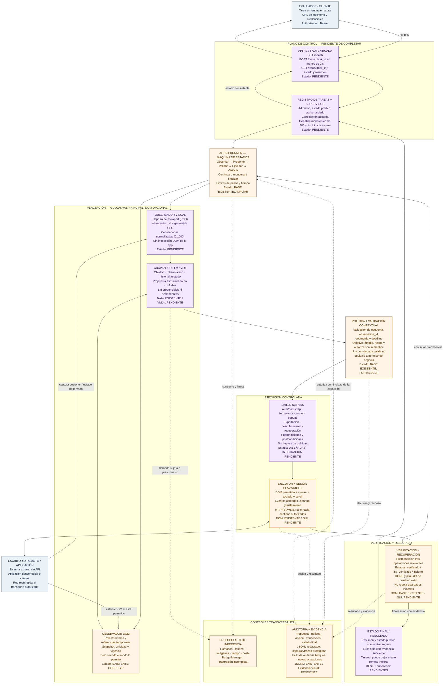

# WEB-AGENT — Diagrama de arquitectura

## Propósito

Este documento contiene el diagrama de arquitectura objetivo de WEB-AGENT en formato Mermaid, más una descripción textual de los componentes y sus fronteras. Está pensado para lectura por agentes y herramientas que procesan Markdown.

**Principio central:** GUI/canvas es la modalidad principal; DOM es opcional. El modelo produce propuestas no confiables. Un núcleo propio valida, autoriza, ejecuta, verifica y audita cada acción.

> **Advertencia de estado:** este diagrama representa el diseño objetivo. Las etiquetas `EXISTENTE`, `PARCIAL` y `PENDIENTE` proceden de la revisión estática resumida en el material fuente; no constituyen evidencia de pruebas funcionales o despliegue.

## Leyenda de estados

- **Existente:** el material fuente identifica una base o módulo en el código compartido, sin certificación de calidad funcional.
- **Parcial:** la base existe, pero la integración o las garantías son incompletas.
- **Pendiente / diseñado:** forma parte de la arquitectura objetivo, pero su implementación no está demostrada.
- **Sistema externo:** fuera del núcleo de control de WEB-AGENT.

## Diagrama principal

## Secuencia de ejecución

1. El evaluador envía la tarea y las credenciales o parámetros del escritorio al endpoint REST autenticado.
2. La API valida el token y el payload, registra la tarea, fija los límites y devuelve `task_id` sin esperar a que termine la automatización.
3. El supervisor administra el estado público, el worker y el deadline monotónico de 300 segundos.
4. El runner solicita una observación visual y/o DOM, según el modo permitido por la tarea y el entorno.
5. El adaptador de modelo recibe el objetivo y la observación; devuelve una propuesta estructurada no confiable. El proveedor no obtiene acceso directo a herramientas ni credenciales.
6. El núcleo valida esquema, identidad y vigencia de la observación, geometría, contexto, objetivo y política de autorización.
7. Una skill opcional organiza pasos reutilizables, pero toda acción se ejecuta mediante el mismo ejecutor y sin eludir las políticas.
8. Playwright emite eventos de interfaz limitados a la sesión y a los destinos de red autorizados.
9. El sistema vuelve a observar y verifica una postcondición observable. Si el resultado no puede determinarse, se informa `incierto` en lugar de asumir éxito o repetir ciegamente una operación persistente.
10. La auditoría registra los hitos. Si un evento obligatorio no puede escribirse, la ejecución no debe continuar como si nada hubiera pasado.
11. El supervisor publica el estado final y la API permite consultar un resumen que no expone secretos ni evidencia sensible.

## Componentes y responsabilidades

| Componente | Responsabilidad | Estado resumido |
|---|---|---|
| Evaluador / cliente | Proporcionar tarea, acceso al escritorio y autorización Bearer. | Actor externo. |
| API REST | Autenticación, validación, admisión rápida y consulta de estado. | Pendiente según la fuente. |
| Registro + supervisor | Estado de tarea, deadline de 300 s, worker, cancelación y publicación del resultado. | Pendiente. |
| AgentRunner | Máquina de estados, límites, ciclo de propuesta/acción/verificación. | Base existente; debe ampliarse. |
| Observador visual | Captura del viewport, geometría CSS e ID de observación; opera sin inspección DOM en `visual_only`. | Pendiente. |
| Observador DOM | Roles, nombres y referencias temporales cuando la modalidad lo permite. | Existente; requiere correcciones. |
| Adaptador LLM/VLM | Convertir objetivo y observación en una propuesta estructurada. | Texto existente; visión pendiente según la fuente. |
| Política y validador | Rechazar propuestas inválidas, obsoletas o fuera del alcance autorizado. | Base existente; fortalecer vínculo contextual. |
| Skills nativas | Reutilizar procedimientos de autenticación, formularios, popups, exportación, descubrimiento y recuperación. | Diseñadas; integración pendiente. |
| Ejecutor + Playwright | Traducir acciones permitidas a eventos de interfaz acotados y limpiar recursos. | DOM existente; GUI visual pendiente. |
| Aplicación remota | Superficie externa que recibe mouse, teclado y otros eventos permitidos. | Sistema externo. |
| Presupuesto | Limitar llamadas, tokens, imágenes, tiempo y coste de inferencia. | Integración incompleta. |
| Auditoría | Registrar propuestas, decisiones, acciones, verificaciones y estado final con redacción. | JSONL existente; evidencia visual pendiente. |
| Verificador / recuperación | Comprobar postcondiciones y recuperarse sin duplicar operaciones persistentes. | Base DOM existente; verificación GUI pendiente. |
| Estado final | Resumir resultados y motivo de fallo/bloqueo sin exponer secretos. | Depende de REST/supervisor pendientes. |

## Límites y garantías que el diagrama no debe ocultar

- La arquitectura objetivo no es evidencia de que todos los componentes estén implementados.
- `DONE`, un click aceptado, una navegación completada o una diferencia de píxeles no prueban por sí solos el éxito de negocio.
- Una coordenada válida dentro del viewport no demuestra que la acción esté autorizada por el objetivo.
- Una observación obsoleta o una geometría incompatible debe provocar rechazo y nueva observación.
- BrowserContext aísla parte del estado del navegador, pero no sustituye aislamiento de proceso, filesystem ni red.
- El uso de WebSockets debe limitarse a destinos explícitamente autorizados; no se deben abrir destinos arbitrarios.
- El plazo de 300 segundos debe aplicarse en el supervisor, independientemente del perfil de tarea recibido.
- Un timeout después de una acción persistente puede dejar efectos remotos inciertos; detener el worker no revierte la acción.
- JSONL redactado no equivale a una auditoría criptográficamente inmutable.
- El proveedor de inferencia es una dependencia externa y no debe recibir credenciales ni capacidad de ejecución.
- El uso de proveedores externos queda condicionado a las reglas oficiales de la evaluación.

## Contratos e interfaces clave

- **REST:** `GET /health`, `POST /tasks`, `GET /tasks/{task_id}`; Bearer y esquema de respuesta sujetos al contrato oficial.
- **Tiempo:** deadline monotónico de máximo 300 s, incluida la espera de la tarea.
- **Observación:** `observation_id`, timestamps, sesión/página, geometría CSS, tamaño/transformación de imagen y referencia controlada.
- **Propuesta:** salida estructurada no confiable ligada a una observación y al contexto de tarea.
- **Autorización:** validación de esquema más política contextual y semántica; el esquema sintáctico por sí solo no concede permiso.
- **Resultado de verificación:** `verificado`, `no_verificado` o `incierto`.
- **Auditoría:** correlación por `task_id`, `run_id` y `observation_id`; redacción de secretos y protección de evidencias.

## Referencia al documento técnico complementario

Para los detalles de los defectos reportados, prioridades, fases, pruebas y criterios de aceptación, consultar `web-agent_arquitectura_implementacion.md`.
