# 🌐 web-agent

> **Agente generalista autónomo de automatización web con modo prioritario visual (Canvas / GUI Desktop), políticas de seguridad estrictas, supervisión con aislamiento en subprocesos y contrato REST para evaluación oficial.**

[](https://www.python.org/)
[](https://playwright.dev/)
[](https://fastapi.tiangolo.com/)
[]()
[](./Diseño/WEB-AGENT_documento_maestro_de_diseno.md)

---

## 📑 Tabla de Contenidos

1. [Visión General y Propósito](#-visión-general-y-propósito)
2. [Arquitectura y Principios de Diseño](#-arquitectura-y-principios-de-diseño)
3. [Estructura del Proyecto](#-estructura-del-proyecto)
4. [Documentación Técnica y Entregables](#-documentación-técnica-y-entregables)
5. [Contrato de la API de Evaluación Oficial](#-contrato-de-la-api-de-evaluación-oficial)
6. [Guía de Inicio Rápido](#-guía-de-inicio-rápido)
7. [Ejecución por Línea de Comandos (CLI)](#-ejecución-por-línea-de-comandos-cli)
8. [Pruebas Automatizadas y Calidad](#-pruebas-automatizadas-y-calidad)
9. [Despliegue Contenerizado con Docker](#-despliegue-contenerizado-con-docker)
10. [Seguridad y Mitigación de Riesgos](#-seguridad-y-mitigación-de-riesgos)

---

## 🎯 Visión General y Propósito

**`web-agent`** es un sistema autónomo diseñado para operar aplicaciones web y sistemas legacy sin APIs formales ni selectores DOM confiables (aplicaciones renderizadas en Canvas gráfico, WebGL o escritorios remotos).

El agente interactúa mediante percepción visual directa (capturas de pantalla de alta resolución y modelos multimodales VLM), aplicando coordenadas normalizadas $[0, 1000] \to \text{CSS } (x, y)$ y restringiendo cada acción bajo un modelo de riesgos cerrado ($R_0 \dots R_3$) que garantiza ejecución determinista, supervisión con límite duro de 300 segundos y trazabilidad auditable *fail-safe*.

---

## 🏗️ Arquitectura y Principios de Diseño

El sistema opera bajo un bucle determinista de control estricto:

$$\text{Observar} \longrightarrow \text{Proponer} \longrightarrow \text{Validar} \longrightarrow \text{Actuar} \longrightarrow \text{Verificar} \longrightarrow \text{Auditar}$$

```mermaid
flowchart LR
    A["Evaluador / API Externa"] -->|"POST /tasks (Bearer)"| B["API FastAPI\n(app.py)"]
    B -->|"Encola y responde <2s"| C["Supervisor\n(supervisor.py)"]
    C -->|"Spawn subproceso aislado\nDeadline 300s"| D["Worker Subprocess\n(worker.py)"]
    D --> E["AgentRunner\n(runner.py)"]
    
    subgraph Bucle["Bucle Autónomo Visual"]
        E -->|"Captura viewport"| F["Percepción Visual\n(observe_visual.py)"]
        F -->|"Screenshot + Prompt"| G["VLM Multimodal\n(OpenRouter / Gemini)"]
        G -->|"Acción propuesta"| H["Validador R0-R3\n(policy.py / validator.py)"]
        H -->|"Ejecución ratón/teclado"| I["Navegador Playwright\n(session.py / executor.py)"]
        I -->|"Verificación de estado"| J["Verificador\n(verifier.py)"]
        J -->|"Log inmutable JSONL"| K["Auditoría Fail-Safe\n(events.py)"]
    end
```



### Principios Fundamentales

1. **Visión como Modo Principal ([ADR-001](./Diseño/decisiones/ADR-001-vision-como-modo-principal.md) / [ADR-002](./Diseño/decisiones/ADR-002-ejecucion-determinista.md)):**
   El agente no depende de selectores CSS frágiles ni del árbol DOM. La interacción se fundamenta en imágenes del lienzo y espacio geométrico normalizado $[0, 1000]$.
2. **Espacio de Acciones Cerrado y Política $R_0 \dots R_3$ ([ADR-003](./Diseño/decisiones/ADR-003-limites-dependencias-y-proveedores.md)):**
   - **$R_0$:** Observación, espera activa, verificación.
   - **$R_1$:** Clics, escritura de texto, arrastre de ratón (`mouse_drag`), atajos de teclado seguros.
   - **$R_2$:** Envío de formularios, guardado y descargas dentro de los orígenes autorizados.
   - **$R_3$:** Acciones destructivas o irreversibles (bloqueadas *fail-closed* $\to$ terminación segura).
3. **Supervisión con Plazo Absoluto y Aislamiento en Subprocesos ([ADR-009](./Diseño/decisiones/ADR-009-deadline-supervisado-absoluto.md) / [ADR-011](./Diseño/decisiones/ADR-011-servicio-modular.md)):**
   Cada tarea corre en un subproceso operativo (`subprocess`) vigilado por un `Deadline` absoluto de 300 segundos. Si el tiempo expira o se detecta bloqueo, el supervisor termina el subproceso completo junto con Chromium para liberar recursos.
4. **Protección de Credenciales y Mitigación SSRF:**
   Las contraseñas se manejan exclusivamente mediante referencias (`secret_ref: "desktop_password"`) inyectadas en memoria. Jamás llegan al modelo VLM, ni a los prompts, ni a los registros de auditoría.
5. **Ruta Crítica sin Dependencias Externas Innecesarias ([ADR-010](./Diseño/decisiones/ADR-010-mcp-fuera-ruta-critica.md)):**
   Las habilidades especializadas (autenticación, gestión de modales, recuperación) están codificadas nativamente en Python sin capas MCP adicionales.

---

## 📁 Estructura del Proyecto

```
web-agent/
├── src/
│   └── web_agent/
│       ├── api/               # API REST FastAPI para el evaluador del hackathon
│       │   ├── app.py         # Endpoints: GET /health, POST /tasks, GET /tasks/{id}
│       │   ├── auth.py        # Validación en tiempo constante de token Bearer
│       │   └── dto.py         # Esquemas Pydantic v2 de entrada y salida
│       ├── audit/             # Registro append-only fail-safe
│       │   └── events.py      # Persistencia inmutable en JSONL con hash y redacción
│       ├── browser/           # Integración con Playwright Chromium
│       │   ├── actions.py     # Despachador de acciones (click, type, hotkey, drag)
│       │   ├── executor.py    # Ejecutor coordinado sobre la sesión del navegador
│       │   ├── locate.py      # Resuelve coordenadas relativas y transformaciones
│       │   ├── observe.py     # Observador híbrido DOM
│       │   ├── observe_visual.py # Observador de lienzo visual y capturas PNG
│       │   └── session.py     # Sesión Playwright con sandbox y políticas de red
│       ├── core/              # Lógica central del agente y modelos de dominio
│       │   ├── action_validator.py # Validación contextual contra la observación vigente
│       │   ├── context.py     # SecretStore y almacén protegido de secretos
│       │   ├── deadline.py    # Control estricto de timeout (300 s)
│       │   ├── errors.py      # Jerarquía tipada de excepciones
│       │   ├── geometry.py    # Geometría [0, 1000] <-> CSS pixels
│       │   ├── observation.py # Snapshots inmutables con observation_id único
│       │   ├── policy.py      # Enforcer de seguridad de acciones R0-R3
│       │   ├── result.py      # Estado final y resumen de ejecución
│       │   ├── runner.py      # AgentRunner: bucle principal de control
│       │   ├── schemas.py     # Modelos de perfil, tareas, acciones y percepción
│       │   └── verifier.py    # Verificación determinista antes de declarar DONE
│       ├── execution/         # Control presupuestario y cuotas
│       │   └── budgets.py     # Contabilidad en Decimal para costos de inferencia
│       ├── models/            # Integración con proveedores de lenguaje y visión
│       │   ├── adapters/      # OpenRouter (multimodal) y Scripted (fakes/tests)
│       │   ├── base.py        # Interfaz abstracta BaseModelProvider
│       │   └── prompting.py   # Formateo de prompts y extracción estructurada
│       ├── recovery/          # Estrategias de autorecuperación
│       │   └── strategies.py  # Desatasco tras acciones fallidas sin bucles ciegos
│       ├── security/          # Mitigaciones de red y seguridad
│       │   ├── network_policy.py # Control de orígenes y mitigación SSRF
│       │   ├── origins.py     # Clasificación y validación de URLs
│       │   └── redaction.py   # Censura automática de tokens y contraseñas
│       ├── service/           # Capa de servicio y orquestación
│       │   ├── supervisor.py  # Gestor de concurrencia y deadlines de subprocesos
│       │   ├── task_manager.py# Fachada de creación y consulta de tareas
│       │   ├── task_store.py  # Almacén de estado en memoria y persistente
│       │   └── worker.py      # Entrypoint ejecutor en subproceso independiente
│       ├── skills/            # Procedimientos nativos para tareas repetitivas
│       │   ├── auth_bootstrap.py    # Auto-login mediante coordenadas o formulario
│       │   ├── guidance_skills.py   # Modales, diálogos y descargas
│       │   └── self_healing_retry.py# Reintento inteligente tras cambios visuales
│       ├── cli.py             # Comandos de terminal (doctor, serve, run, inspect)
│       ├── config.py          # Configuración por variables de entorno (Settings)
│       ├── doctor.py          # Diagnóstico local de dependencias y Chromium
│       ├── entrypoint.py      # Módulo ASGI oficial para evaluación
│       └── __init__.py
├── tests/                     # Suite completa de pruebas (102 tests)
│   ├── integration/           # Pruebas de contrato HTTP FastAPI
│   ├── scenarios/             # Pruebas con páginas sintéticas y canvas
│   ├── security/              # Pruebas de SSRF, redacción y presupuestos
│   └── unit/                  # Geometría, validación de políticas y runner
├── profiles/                  # Perfiles declarativos YAML
│   └── examples/
│       └── portal_demo.yaml
├── data/                      # Registros locales de auditoría y evidencias (ignorado en git)
├── Diseño/                    # Documentación arquitectónica completa y formal
│   ├── decisiones/            # Registros de Decisión de Arquitectura (ADR-001..011)
│   ├── WEB-AGENT_documento_maestro_de_diseno.md # Documento Maestro Normativo
│   ├── resumen_ejecutivo_unapagina.pdf          # Resumen Ejecutivo (1 página oficial)
│   ├── diagrama_arquitectura.svg                # Diagrama de Arquitectura vectorial
│   ├── diagrama_arquitectura.png                # Renderizado PNG de alta resolución
│   └── despliegue_y_operacion.md                # Manual operativo para el evaluador
├── .env.example               # Plantilla exhaustiva de variables de entorno
├── Dockerfile                 # Contenedor oficial para despliegue de evaluación
├── .dockerignore              # Exclusiones de construcción Docker
├── main.py                    # Punto de entrada principal CLI
├── pyproject.toml             # Definición del proyecto y dependencias (PEP 621)
└── uv.lock                    # Bloqueo determinista de dependencias
```

---

## 📚 Documentación Técnica y Entregables

Toda la documentación técnica formal se encuentra versionada dentro de la carpeta [`Diseño/`](./Diseño/README.md):

| Documento | Enlace | Propósito |
| :--- | :--- | :--- |
| **Resumen Ejecutivo (1 Página)** | [**`resumen_ejecutivo_unapagina.pdf`**](./Diseño/resumen_ejecutivo_unapagina.pdf) | **Documento PDF oficial de 1 página** con alta densidad técnica para entrega ejecutiva. |
| **Diagrama de Arquitectura** | [**`diagrama_arquitectura.svg`**](./Diseño/diagrama_arquitectura.svg) / [**`.png`**](./Diseño/diagrama_arquitectura.png) | Esquema gráfico completo de capas, componentes y flujo de datos. |
| **Documento Maestro de Diseño** | [**`WEB-AGENT_documento_maestro_de_diseno.md`**](./Diseño/WEB-AGENT_documento_maestro_de_diseno.md) | **Especificación normativa exhaustiva** (22 secciones, contratos tipados y seguridad). |
| **Manual de Despliegue y Operación** | [**`despliegue_y_operacion.md`**](./Diseño/despliegue_y_operacion.md) | Guía de variables de entorno, Docker y checklist de evaluación. |
| **Contrato de Acciones** | [**`contrato_acciones_observaciones.md`**](./Diseño/contrato_acciones_observaciones.md) | Esquemas de observación geométrica y catálogo cerrado de acciones. |
| **Seguridad y Amenazas** | [**`seguridad_y_modelo_amenazas.md`**](./Diseño/seguridad_y_modelo_amenazas.md) | Modelo de mitigación contra SSRF, inyecciones y fugas de secretos. |
| **Registro de Decisiones (ADRs)** | [**`decisiones/`**](./Diseño/decisiones/) | 11 ADRs documentando cada decisión crítica del sistema. |

---

## 📡 Contrato de la API de Evaluación Oficial

El servicio expone una interfaz ASGI estándar sobre el puerto 8000 para interactuar con la plataforma de evaluación del evento.

Todas las peticiones exigen el encabezado de autenticación Bearer:
```http
Authorization: Bearer <EVALUATION_BEARER_TOKEN>
```

### Endpoints

#### 1. `GET /health`
Comprueba que el agente está activo y configurado.
- **Respuesta 200 OK:**
  ```json
  {"status": "ok", "provider": "openrouter", "worker_mode": "subprocess"}
  ```

#### 2. `POST /tasks`
Encola una nueva tarea de evaluación y responde asíncronamente en menos de 2 segundos.
- **Cuerpo de la Petición:**
  ```json
  {
    "task": "Navegar a la pantalla de clientes, ingresar usuario 'operador' y exportar informe.",
    "desktop": {
      "url": "http://192.168.1.50:8080/vnc",
      "password": "secreto_del_escritorio"
    }
  }
  ```
- **Respuesta 200 OK / 201 Created:**
  ```json
  {
    "task_id": "c0a80132-7f2a-4a61-9f93-b6c8a7f10123"
  }
  ```

#### 3. `GET /tasks/{task_id}`
Consulta el estado de avance o finalización de una tarea.
- **Respuesta 200 OK:**
  ```json
  {
    "task_id": "c0a80132-7f2a-4a61-9f93-b6c8a7f10123",
    "status": "terminada",
    "steps": 14,
    "summary": "Navegación completada con éxito. Archivo exportado y verificado en pantalla."
  }
  ```
  *Valores posibles de `status`: `en_curso`, `terminada`, `fallida`.*

---

## 🚀 Guía de Inicio Rápido

### Requisitos Previos
- **Python >= 3.12**
- Gestor de dependencias **[uv](https://docs.astral.sh/uv/)**

### 1. Clonar e Instalar Dependencias
```bash
git clone https://github.com/Pirrijean/web-agent.git
cd web-agent
uv sync
```

### 2. Instalar Navegador Chromium para Playwright
```bash
uv run playwright install chromium
```

### 3. Configurar Variables de Entorno
Copia la plantilla `.env.example` y edita tus credenciales:
```bash
cp .env.example .env
```
Asegúrate de configurar:
- `EVALUATION_BEARER_TOKEN`: Token asignado para la evaluación.
- `OPENROUTER_API_KEY`: Tu clave de API para el modelo de visión.

### 4. Diagnóstico del Entorno (`doctor`)
Valida que el sistema, las dependencias y Chromium estén correctamente operativos:
```bash
uv run python main.py doctor
```
O verifica el estado del entrypoint de evaluación:
```bash
uv run python -m web_agent.entrypoint --health
```

---

## 💻 Ejecución por Línea de Comandos (CLI)

### Levantar el Servidor de Evaluación
```bash
uv run python main.py serve
```
El servidor quedará a la escucha en `http://0.0.0.0:8000`.

### Ejecutar una Tarea Directamente
```bash
uv run python main.py run \
  --desktop-url "http://192.168.1.50:8080" \
  --objective "Abrir formulario de facturación e ingresar número de control"
```

### Inspeccionar un Perfil Declarativo YAML
```bash
uv run python main.py inspect-profile profiles/examples/portal_demo.yaml
```

---

## 🧪 Pruebas Automatizadas y Calidad

El repositorio cuenta con una batería completa de **102 pruebas automatizadas** que cubren el 100% de los componentes críticos:

```bash
uv run pytest
```

```
collected 102 items

tests/integration/test_api_contract.py ................                  [ 15%]
tests/scenarios/test_synthetic_canvas.py ..                              [ 17%]
tests/security/test_network_secrets_budget.py ...............            [ 32%]
tests/unit/test_geometry_and_contracts.py .....................          [ 52%]
tests/unit/test_openrouter_adapter.py ...                                [ 55%]
tests/unit/test_runner_visual.py ...............                         [ 70%]
tests/unit/test_validation_and_policy.py ..............................  [100%]

============================ 102 passed ============================
```

### Verificación de Estilo y Linters
```bash
uv run ruff check --select E9,F,B
```

---

## 🐳 Despliegue Contenerizado con Docker

Para desplegar el agente en un contenedor listo para recibir las peticiones del evaluador:

### 1. Construir la Imagen
```bash
docker build -t web-agent:latest .
```

### 2. Ejecutar el Contenedor
```bash
docker run -d \
  --name web-agent \
  -p 8000:8000 \
  -e EVALUATION_BEARER_TOKEN="tu_bearer_token" \
  -e OPENROUTER_API_KEY="tu_openrouter_key" \
  web-agent:latest
```

### 3. Verificar Salud del Servicio
```bash
curl -i -H "Authorization: Bearer tu_bearer_token" http://localhost:8000/health
```

---

## 🔒 Seguridad y Mitigación de Riesgos

- **Aislamiento de Red:** Intercepción estricta en Playwright. Prohibición de esquemas peligrosos (`file://`, `ftp://`), bloqueo de metadatos de nube (`169.254.169.254`) y restricción de WebSocket exclusivamente a la IP y puerto del escritorio remoto indicado.
- **Fail-Closed Policy:** Cualquier acción con parámetros incompletos, coordenadas fuera del rango $[0, 1000]$ o fuera de la observación actual es rechazada inmediatamente sin alcanzar el navegador.
- **Auditoría Append-Only:** Todo evento se almacena en `data/audit/*.jsonl`. Si el sistema de persistencia de auditoría falla, la ejecución se detiene automáticamente por seguridad (*fail-stop*).
- **Manejo Seguro de Credenciales:** La contraseña del escritorio se pasa como variable de entorno o en el payload inicial, guardándose en un almacén en memoria cifrado/referenciado. Nunca se imprime en stdout, logs ni se transmite a APIs de inferencia.
