# 🌐 web-agent

> **Agente generalista autónomo de automatización web con modo prioritario visual (Canvas / GUI Desktop), políticas de seguridad estrictas, supervisión con aislamiento en subprocesos y contrato REST para evaluación oficial.**

[](https://www.python.org/)
[](https://playwright.dev/)
[](https://fastapi.tiangolo.com/)
[]()
[](./Diseño/WEB-AGENT_documento_maestro_de_diseno.md)

---

## 📑 Tabla de Contenidos

1. [Visión General y Propósito](#-visión-general-y-propósito)
2. [Arquitectura y Principios de Diseño](#-arquitectura-y-principios-de-diseño)
3. [Estructura del Proyecto](#-estructura-del-proyecto)
4. [Documentación Técnica y Entregables](#-documentación-técnica-y-entregables)
5. [Contrato de la API de Evaluación Oficial](#-contrato-de-la-api-de-evaluación-oficial)
6. [Guía de Inicio Rápido](#-guía-de-inicio-rápido)
7. [Pruebas Automatizadas y Calidad](#-pruebas-automatizadas-y-calidad)
8. [Despliegue Contenerizado con Docker](#-despliegue-contenerizado-con-docker)
9. [Seguridad y Mitigación de Riesgos](#-seguridad-y-mitigación-de-riesgos)

---

## 🎯 Visión General y Propósito

**`web-agent`** es un sistema autónomo diseñado para operar aplicaciones web y sistemas legacy sin APIs formales ni selectores DOM confiables (aplicaciones renderizadas en Canvas gráfico, WebGL o escritorios remotos).

El agente interactúa mediante percepción visual directa (capturas de pantalla de alta resolución y modelos multimodales VLM), aplicando coordenadas normalizadas $[0, 1000] \to \text{CSS } (x, y)$ y restringiendo cada acción bajo un modelo de riesgos cerrado ($R_0 \dots R_3$) que garantiza ejecución determinista, supervisión con límite duro de 300 segundos y trazabilidad auditable *fail-safe*.

---

## 🏗️ Arquitectura y Principios de Diseño

El sistema opera bajo un bucle determinista de control estricto:

$$\text{Observar} \longrightarrow \text{Proponer} \longrightarrow \text{Validar} \longrightarrow \text{Actuar} \longrightarrow \text{Verificar} \longrightarrow \text{Auditar}$$

```mermaid
flowchart LR
    A["Evaluador / API Externa"] -->|"POST /tasks (Bearer)"| B["API FastAPI\n(app.py)"]
    B -->|"Encola y responde <2s"| C["Supervisor\n(supervisor.py)"]
    C -->|"Spawn subproceso aislado\nDeadline 300s"| D["Worker Subprocess\n(worker.py)"]
    D --> E["AgentRunner\n(runner.py)"]
    
    subgraph Bucle["Bucle Autónomo Visual"]
        E -->|"Captura viewport"| F["Percepción Visual\n(observe_visual.py)"]
        F -->|"Screenshot + Prompt"| G["VLM Multimodal\n(OpenRouter / Gemini)"]
        G -->|"Acción propuesta"| H["Validador R0-R3\n(policy.py / validator.py)"]
        H -->|"Ejecución ratón/teclado"| I["Navegador Playwright\n(session.py / executor.py)"]
        I -->|"Verificación de estado"| J["Verificador\n(verifier.py)"]
        J -->|"Log inmutable JSONL"| K["Auditoría Fail-Safe\n(events.py)"]
    end
```



### Principios Fundamentales

1. **Visión como Modo Principal ([ADR-001](./Diseño/decisiones/ADR-001-vision-como-modo-principal.md) / [ADR-002](./Diseño/decisiones/ADR-002-ejecucion-determinista.md)):**
   El agente no depende de selectores CSS frágiles ni del árbol DOM. La interacción se fundamenta en imágenes del lienzo y espacio geométrico normalizado $[0, 1000]$.
2. **Espacio de Acciones Cerrado y Política $R_0 \dots R_3$ ([ADR-003](./Diseño/decisiones/ADR-003-limites-dependencias-y-proveedores.md)):**
   - **$R_0$:** Observación, espera activa, verificación.
   - **$R_1$:** Clics, escritura de texto, arrastre de ratón (`mouse_drag`), atajos de teclado seguros.
   - **$R_2$:** Envío de formularios, guardado y descargas dentro de los orígenes autorizados.
   - **$R_3$:** Acciones destructivas o irreversibles (bloqueadas *fail-closed* $\to$ terminación segura).
3. **Supervisión con Plazo Absoluto y Aislamiento en Subprocesos ([ADR-009](./Diseño/decisiones/ADR-009-deadline-supervisado-absoluto.md) / [ADR-011](./Diseño/decisiones/ADR-011-servicio-modular.md)):**
   Cada tarea corre en un subproceso operativo (`subprocess`) vigilado por un `Deadline` absoluto de 300 segundos. Si el tiempo expira o se detecta bloqueo, el supervisor termina el subproceso completo junto con Chromium para liberar recursos.
4. **Protección de Credenciales y Mitigación SSRF:**
   Las contraseñas se manejan exclusivamente mediante referencias (`secret_ref: "desktop_password"`) inyectadas en memoria. Jamás llegan al modelo VLM, ni a los prompts, ni a los registros de auditoría.
5. **Ruta Crítica sin Dependencias Externas Innecesarias ([ADR-010](./Diseño/decisiones/ADR-010-mcp-fuera-ruta-critica.md)):**
   Las habilidades especializadas (autenticación, gestión de modales, recuperación) están codificadas nativamente en Python sin capas MCP adicionales.

---

## 📁 Estructura del Proyecto

```
web-agent/
├── src/
│   └── web_agent/
│       ├── api/               # API REST FastAPI para el evaluador del hackathon
│       │   ├── app.py         # Endpoints: GET /health, POST /tasks, GET /tasks/{id} y consola /
│       │   ├── static/        # Consola web (HTML/CSS/JS estáticos, sin secretos, CSP estricta)
│       │   ├── auth.py        # Validación en tiempo constante de token Bearer
│       │   └── dto.py         # Esquemas Pydantic v2 de entrada y salida
│       ├── audit/             # Registro append-only fail-safe
│       │   └── events.py      # Persistencia inmutable en JSONL con hash y redacción
│       ├── browser/           # Integración con Playwright Chromium
│       │   ├── actions.py     # Despachador de acciones (click, type, hotkey, drag)
│       │   ├── executor.py    # Ejecutor coordinado sobre la sesión del navegador
│       │   ├── locate.py      # Resuelve coordenadas relativas y transformaciones
│       │   ├── observe.py     # Observador híbrido DOM
│       │   ├── observe_visual.py # Observador de lienzo visual y capturas PNG
│       │   └── session.py     # Sesión Playwright con sandbox y políticas de red
│       ├── core/              # Lógica central del agente y modelos de dominio
│       │   ├── action_validator.py # Validación contextual contra la observación vigente
│       │   ├── context.py     # SecretStore y almacén protegido de secretos
│       │   ├── deadline.py    # Control estricto de timeout (300 s)
│       │   ├── errors.py      # Jerarquía tipada de excepciones
│       │   ├── geometry.py    # Geometría [0, 1000] <-> CSS pixels
│       │   ├── observation.py # Snapshots inmutables con observation_id único
│       │   ├── policy.py      # Enforcer de seguridad de acciones R0-R3
│       │   ├── result.py      # Estado final y resumen de ejecución
│       │   ├── runner.py      # AgentRunner: bucle principal de control
│       │   ├── schemas.py     # Modelos de perfil, tareas, acciones y percepción
│       │   └── verifier.py    # Verificación determinista antes de declarar DONE
│       ├── execution/         # Control presupuestario y cuotas
│       │   └── budgets.py     # Contabilidad en Decimal para costos de inferencia
│       ├── models/            # Integración con proveedores de lenguaje y visión
│       │   ├── adapters/      # OpenRouter (multimodal) y Scripted (fakes/tests)
│       │   ├── base.py        # Interfaz abstracta BaseModelProvider
│       │   └── prompting.py   # Formateo de prompts y extracción estructurada
│       ├── recovery/          # Estrategias de autorecuperación
│       │   └── strategies.py  # Desatasco tras acciones fallidas sin bucles ciegos
│       ├── security/          # Mitigaciones de red y seguridad
│       │   ├── network_policy.py # Control de orígenes y mitigación SSRF
│       │   ├── origins.py     # Clasificación y validación de URLs
│       │   └── redaction.py   # Censura automática de tokens y contraseñas
│       ├── service/           # Capa de servicio y orquestación
│       │   ├── supervisor.py  # Gestor de concurrencia y deadlines de subprocesos
│       │   ├── task_manager.py# Fachada de creación y consulta de tareas
│       │   ├── task_store.py  # Almacén de estado en memoria y persistente
│       │   └── worker.py      # Entrypoint ejecutor en subproceso independiente
│       ├── skills/            # Procedimientos nativos para tareas repetitivas
│       │   ├── auth_bootstrap.py    # Auto-login mediante coordenadas o formulario
│       │   ├── guidance_skills.py   # Modales, diálogos y descargas
│       │   └── self_healing_retry.py# Reintento inteligente tras cambios visuales
│       ├── cli.py             # Comandos de terminal (doctor, serve, run, inspect)
│       ├── config.py          # Configuración por variables de entorno (Settings)
│       ├── doctor.py          # Diagnóstico local de dependencias y Chromium
│       ├── entrypoint.py      # Módulo ASGI oficial para evaluación
│       └── __init__.py
├── tests/                     # Suite completa de pruebas (102 tests)
│   ├── integration/           # Pruebas de contrato HTTP FastAPI
│   ├── scenarios/             # Pruebas con páginas sintéticas y canvas
│   ├── security/              # Pruebas de SSRF, redacción y presupuestos
│   └── unit/                  # Geometría, validación de políticas y runner
├── profiles/                  # Perfiles declarativos YAML
│   └── examples/
│       └── portal_demo.yaml
├── data/                      # Registros locales de auditoría y evidencias (ignorado en git)
├── Diseño/                    # Documentación arquitectónica completa y formal
│   ├── decisiones/            # Registros de Decisión de Arquitectura (ADR-001..011)
│   ├── WEB-AGENT_documento_maestro_de_diseno.md # Documento Maestro Normativo
│   ├── resumen_ejecutivo_unapagina.pdf          # Resumen Ejecutivo (1 página oficial)
│   ├── diagrama_arquitectura.svg                # Diagrama de Arquitectura vectorial
│   ├── diagrama_arquitectura.png                # Renderizado PNG de alta resolución
│   └── despliegue_y_operacion.md                # Manual operativo para el evaluador
├── .env.example               # Plantilla exhaustiva de variables de entorno
├── Dockerfile                 # Contenedor oficial para despliegue de evaluación
├── .dockerignore              # Exclusiones de construcción Docker
├── main.py                    # Punto de entrada principal CLI
├── pyproject.toml             # Definición del proyecto y dependencias (PEP 621)
└── uv.lock                    # Bloqueo determinista de dependencias
```

---

## 📚 Documentación Técnica y Entregables

Toda la documentación técnica formal se encuentra versionada dentro de la carpeta [`Diseño/`](./Diseño/README.md):

| Documento | Enlace | Propósito |
| :--- | :--- | :--- |
| **Resumen Ejecutivo (1 Página)** | [**`resumen_ejecutivo_unapagina.pdf`**](./Diseño/resumen_ejecutivo_unapagina.pdf) | **Documento PDF oficial de 1 página** con alta densidad técnica para entrega ejecutiva. |
| **Diagrama de Arquitectura** | [**`diagrama_arquitectura.svg`**](./Diseño/diagrama_arquitectura.svg) / [**`.png`**](./Diseño/diagrama_arquitectura.png) | Esquema gráfico completo de capas, componentes y flujo de datos. |
| **Documento Maestro de Diseño** | [**`WEB-AGENT_documento_maestro_de_diseno.md`**](./Diseño/WEB-AGENT_documento_maestro_de_diseno.md) | **Especificación normativa exhaustiva** (22 secciones, contratos tipados y seguridad). |
| **Manual de Despliegue y Operación** | [**`despliegue_y_operacion.md`**](./Diseño/despliegue_y_operacion.md) | Guía de variables de entorno, Docker y checklist de evaluación. |
| **Contrato de Acciones** | [**`contrato_acciones_observaciones.md`**](./Diseño/contrato_acciones_observaciones.md) | Esquemas de observación geométrica y catálogo cerrado de acciones. |
| **Seguridad y Amenazas** | [**`seguridad_y_modelo_amenazas.md`**](./Diseño/seguridad_y_modelo_amenazas.md) | Modelo de mitigación contra SSRF, inyecciones y fugas de secretos. |
| **Registro de Decisiones (ADRs)** | [**`decisiones/`**](./Diseño/decisiones/) | 11 ADRs documentando cada decisión crítica del sistema. |

---

## 📡 Contrato de la API de Evaluación Oficial

El servicio expone una aplicación ASGI (FastAPI + Uvicorn) en el puerto `8000` (configurable con `PORT`).

Todas las rutas de la API exigen autenticación Bearer:
```http
Authorization: Bearer <EVALUATION_BEARER_TOKEN>
```

| Método | Ruta | Descripción |
|---|---|---|
| `GET` | `/health` | `200` si el servicio está listo (token y modelo configurados); `503` si no. |
| `POST` | `/tasks` | Admite la tarea en menos de 2 s y devuelve su `task_id`. La ejecución continúa en un subproceso supervisado. |
| `GET` | `/tasks/{task_id}` | Estado público de la tarea. |
| `GET` | `/` | Consola web (pública, sin datos; el token se introduce en el navegador). |

#### `GET /health`
```json
{"status": "healthy", "service": "web-agent", "ready": true, "model_configured": true,
 "running_tasks": 0, "active_tasks": 0, "max_concurrent_tasks": 2}
```

#### `POST /tasks`
```json
{"task": "Abrir el módulo de clientes y exportar el informe a Excel",
 "desktop": {"url": "https://escritorio.ejemplo/vnc.html", "password": "contraseña_del_escritorio"}}
```
Respuesta `200`:
```json
{"task_id": "task_2b2ea7a108614091837e"}
```

#### `GET /tasks/{task_id}`
```json
{"task_id": "task_2b2ea7a108614091837e", "status": "terminada",
 "resumen": "Informe exportado y visible en pantalla.", "steps_executed": 14, "elapsed_seconds": 41.2,
 "estado_interno": "succeeded_verified", "verificacion": "verificado", "posibles_efectos_sin_confirmar": false}
```
`status` toma uno de: `en_curso`, `terminada`, `fallida`. Ninguna respuesta incluye la contraseña del escritorio.

---

## 🚀 Guía de Inicio Rápido

### Requisitos Previos
- **Python ≥ 3.12** y **[uv](https://docs.astral.sh/uv/)**, o bien **Docker**.

### 1. Instalar dependencias y Chromium
```bash
git clone https://github.com/Pirrijean/web-agent.git
cd web-agent
uv sync
uv run playwright install chromium
```

### 2. Configurar variables de entorno
```bash
cp .env.example .env
```
Como mínimo: `EVALUATION_BEARER_TOKEN` y `OPENROUTER_API_KEY`. Para probar la interfaz sin modelo real usa `WEB_AGENT_MODEL_PROVIDER=scripted` (proveedor simulado, solo para pruebas).

### 3. Levantar el servicio y la consola
```bash
uv run python main.py serve
```
Abre **http://localhost:8000**, pulsa **Acceso**, introduce el token y envía una tarea. La consola muestra el estado del servicio y el avance de cada tarea; el token vive solo en la pestaña (`sessionStorage`).

Diagnóstico sin lanzar navegador ni consumir inferencia:
```bash
uv run python main.py doctor
uv run python -m web_agent.entrypoint --health
```

### Otros comandos
```bash
uv run python main.py run --desktop-url "https://escritorio.ejemplo/vnc.html" --objective "Abrir el bloc de notas"
uv run python main.py inspect-profile profiles/examples/portal_demo.yaml
```

---

## 🧪 Pruebas Automatizadas y Calidad

```bash
uv run pytest
uv run ruff check src tests --select E9,F,B --ignore B008,B904,E402
```
La suite cubre contrato REST, consola, supervisor y deadline, validación contextual, política R0–R3, red/WebSockets, redacción de secretos, presupuestos y escenarios con Chromium real. La integración continua (`.github/workflows/ci.yml`) ejecuta pruebas, linter y construcción de la imagen en cada PR.

---

## 🐳 Despliegue Contenerizado con Docker

La imagen incluye la API, la consola y Chromium; se ejecuta como usuario sin privilegios (`uid 10001`).

```bash
docker build -t web-agent .
docker run -d --name web-agent -p 8000:8000 \
  --cap-drop=ALL --security-opt no-new-privileges --shm-size=512m --memory=2g \
  -e EVALUATION_BEARER_TOKEN="token_de_evaluacion" \
  -e OPENROUTER_API_KEY="sk-or-..." \
  web-agent
curl -H "Authorization: Bearer token_de_evaluacion" http://localhost:8000/health
```

- **Sandbox de Chromium:** dentro del contenedor se desactiva (`WEB_AGENT_CHROMIUM_SANDBOX=false`) porque el aislamiento lo da el propio contenedor (usuario sin privilegios, sin capacidades). Fuera de un contenedor déjalo en `true`.
- **Memoria:** reserva al menos 1 GB por tarea concurrente (`MAX_CONCURRENT_TASKS`) y `--shm-size` ≥ 256 MB.
- **Auditoría:** se escribe en `/app/data`; monta un volumen ahí si necesitas conservarla.

### Despliegue en una plataforma de contenedores
El flujo recomendado es **GitHub → plataforma de contenedores** (Render, Railway, Fly.io o Google Cloud Run):
1. Conecta el repositorio en la plataforma y elige *Docker* como entorno (usa el `Dockerfile` de la raíz).
2. Define las variables secretas `EVALUATION_BEARER_TOKEN` y `OPENROUTER_API_KEY` en el panel (nunca en el repositorio).
3. Puerto `8000` (o el que asigne la plataforma en `PORT`; el servicio lo respeta). Instancia con ≥ 2 GB de RAM.
4. Cada merge a `main` despliega automáticamente. La sonda de salud puede usar `GET /` (pública).

Vercel no es adecuado para este servicio (funciones sin estado y de corta duración, sin Chromium); puede alojar únicamente contenido estático.

---

## 🔒 Seguridad y Mitigación de Riesgos

- **Aislamiento de Red:** Intercepción estricta en Playwright. Prohibición de esquemas peligrosos (`file://`, `ftp://`), bloqueo de metadatos de nube (`169.254.169.254`) y restricción de WebSocket exclusivamente a la IP y puerto del escritorio remoto indicado.
- **Fail-Closed Policy:** Cualquier acción con parámetros incompletos, coordenadas fuera del rango $[0, 1000]$ o fuera de la observación actual es rechazada inmediatamente sin alcanzar el navegador.
- **Auditoría Append-Only:** Todo evento se almacena en `data/audit/*.jsonl`. Si el sistema de persistencia de auditoría falla, la ejecución se detiene automáticamente por seguridad (*fail-stop*).
- **Manejo Seguro de Credenciales:** La contraseña del escritorio se pasa como variable de entorno o en el payload inicial, guardándose en un almacén en memoria cifrado/referenciado. Nunca se imprime en stdout, logs ni se transmite a APIs de inferencia.
